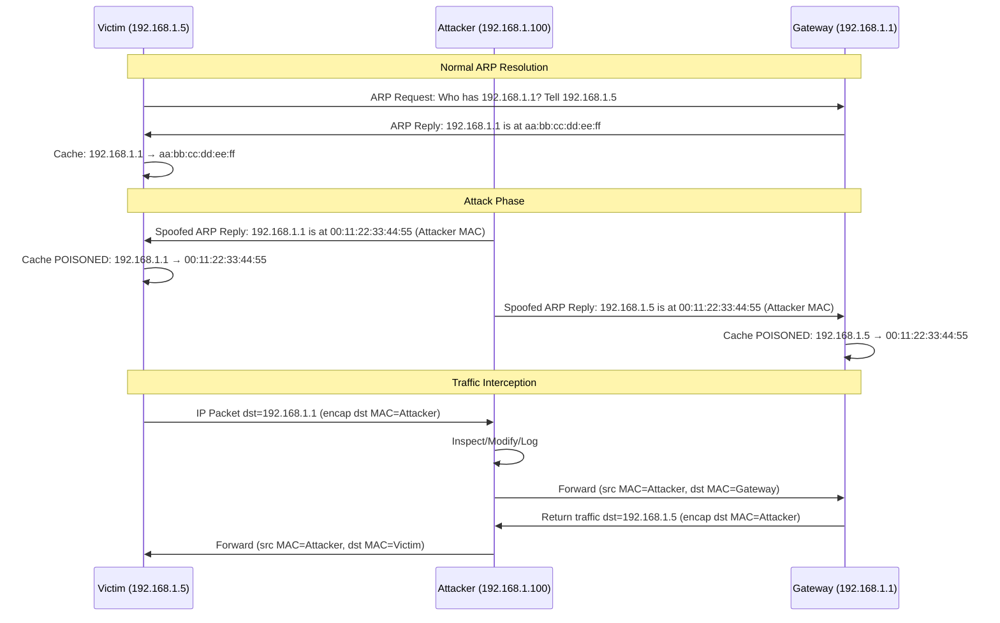

# ARP Poisoning & Spoofing

## What it is
ARP poisoning (or ARP spoofing) is a Layer 2 attack where an attacker sends falsified ARP (Address Resolution Protocol) messages over a local area network to associate their MAC address with the IP address of a legitimate host (typically the default gateway or a target victim). This causes traffic intended for the legitimate host to be redirected to the attacker, enabling man-in-the-middle (MITM) interception, modification, or denial-of-service. The attack exploits ARP's stateless, unauthenticated design — any host can reply to ARP requests or send unsolicited ARP replies (gratuitous ARP), and receivers update their ARP cache without verification.

## Why it matters
ARP poisoning remains the primary enabler of LAN-based MITM attacks, allowing credential theft, session hijacking, TLS stripping, and lateral movement in environments lacking Layer 2 segmentation or dynamic ARP inspection. It affects all IPv4/Ethernet networks regardless of upper-layer encryption, since the attack occurs below IPsec/TLS.

## How it actually works

### ARP Protocol Mechanics (RFC 826)
ARP resolves IPv4 addresses to MAC addresses on Ethernet (hardware type `1`, protocol type `0x0800`). The ARP packet format (28 bytes for Ethernet/IPv4):

```
 0                   1                   2                   3
 0 1 2 3 4 5 6 7 8 9 0 1 2 3 4 5 6 7 8 9 0 1 2 3 4 5 6 7 8 9 0 1
+-+-+-+-+-+-+-+-+-+-+-+-+-+-+-+-+-+-+-+-+-+-+-+-+-+-+-+-+-+-+-+-+
|         Hardware Type (1)       |      Protocol Type (0x0800) |
+-+-+-+-+-+-+-+-+-+-+-+-+-+-+-+-+-+-+-+-+-+-+-+-+-+-+-+-+-+-+-+-+
| Hardware Size (6) | Protocol Size (4) |      Opcode           |
+-+-+-+-+-+-+-+-+-+-+-+-+-+-+-+-+-+-+-+-+-+-+-+-+-+-+-+-+-+-+-+-+
|          Sender Hardware Address (6 bytes)                    |
|                                                               |
+-+-+-+-+-+-+-+-+-+-+-+-+-+-+-+-+-+-+-+-+-+-+-+-+-+-+-+-+-+-+-+-+
|          Sender Protocol Address (4 bytes)                    |
+-+-+-+-+-+-+-+-+-+-+-+-+-+-+-+-+-+-+-+-+-+-+-+-+-+-+-+-+-+-+-+-+
|          Target Hardware Address (6 bytes)                    |
|                                                               |
+-+-+-+-+-+-+-+-+-+-+-+-+-+-+-+-+-+-+-+-+-+-+-+-+-+-+-+-+-+-+-+-+
|          Target Protocol Address (4 bytes)                    |
+-+-+-+-+-+-+-+-+-+-+-+-+-+-+-+-+-+-+-+-+-+-+-+-+-+-+-+-+-+-+-+-+
```

**Opcode values**: `1` = ARP Request, `2` = ARP Reply, `3` = RARP Request, `4` = RARP Reply.

### Attack Sequence
1. **Reconnaissance**: Attacker scans local subnet (e.g., `arp-scan -l` or passive sniffing) to identify target IP/MAC pairs and gateway IP.
2. **Poisoning the victim**: Attacker sends spoofed ARP Reply (opcode `2`) to victim with:
   - Sender MAC: Attacker's MAC
   - Sender IP: Gateway IP
   - Target MAC: Victim's MAC
   - Target IP: Victim IP
   Victim updates ARP cache: `gateway_ip → attacker_mac`.
3. **Poisoning the gateway**: Attacker sends spoofed ARP Reply to gateway with:
   - Sender MAC: Attacker's MAC
   - Sender IP: Victim IP
   - Target MAC: Gateway MAC
   - Target IP: Gateway IP
   Gateway updates ARP cache: `victim_ip → attacker_mac`.
4. **Traffic interception**: Victim sends frames to attacker (thinking it's gateway); attacker forwards to gateway after inspection/modification. Gateway sends frames for victim to attacker; attacker forwards to victim.
5. **Maintenance**: Attacker must re-send spoofed replies periodically (typically every 1-10 seconds) to override legitimate ARP replies and cache timeouts.

### ARP Cache Behavior
- **Linux**: `/proc/sys/net/ipv4/neigh/<iface>/base_reachable_time_ms` (default 30000 ms), `gc_stale_time` (default 60 s). Entries transition: `REACHABLE` → `STALE` → `DELAY` → `PROBE` → `FAILED`.
- **Windows**: Default ARP cache timeout 15-45 seconds (configurable via `netsh interface ipv4 set neighbors`).
- **Gratuitous ARP**: Unsolicited ARP Reply (target IP = sender IP) used for IP conflict detection and cache updates. Attackers exploit this to poison caches without a prior request.

### MITM Variants
- **Bidirectional poisoning**: Both victim and gateway poisoned (full MITM).
- **Unidirectional poisoning**: Only victim poisoned (traffic from victim → attacker → gateway; return path direct). Harder to detect.
- **DoS via ARP**: Poison victim with non-existent MAC (`00:00:00:00:00:00`) or attacker MAC without forwarding.

### Detection Mechanisms
| Method | Mechanism | Limitations |
|--------|-----------|-------------|
| **Dynamic ARP Inspection (DAI)** | Switch validates ARP packets against DHCP snooping binding table (IP-MAC-VLAN-port). Invalid drops. | Requires DHCP snooping; only works on managed switches. |
| **Static ARP entries** | `arp -s <ip> <mac>` (Linux) / `netsh interface ipv4 add neighbors` (Windows). | Doesn't scale; breaks DHCP. |
| **ARP monitoring (arpwatch, XArp)** | Tracks IP-MAC mappings, alerts on changes. | Passive; generates false positives on legitimate changes (VM migration, NIC replacement). |
| **Port Security / MAC limiting** | Limits MACs per switch port; violation actions: restrict, shutdown. | Doesn't prevent poisoning from authorized port. |
| **IPv6 NDP inspection / RA Guard** | Analogous protections for IPv6 Neighbor Discovery Protocol. | Separate protocol; ARP only affects IPv4. |

### Tools & Commands
- **arpspoof** (dsniff): `arpspoof -i eth0 -t 192.168.1.5 192.168.1.1` (poison victim 1.5 with gateway 1.1)
- **ettercap**: `ettercap -T -M arp:remote /192.168.1.5/ /192.168.1.1/`
- **bettercap**: `set arp.spoof.targets 192.168.1.5; arp.spoof on`
- **Detection**: `arp -a` (check for duplicate MACs), `tcpdump -eni eth0 arp` (monitor ARP traffic)

## Architecture / flow



## Key terms
**Gratuitous ARP** — Unsolicited ARP Reply (opcode 2) with sender IP = target IP, used for cache updates and IP conflict detection; exploited for silent cache poisoning.

**ARP Cache (Neighbor Cache)** — Kernel table mapping IPv4 addresses to MAC addresses with state machine (REACHABLE, STALE, DELAY, PROBE, FAILED) and timeout parameters per RFC 4861 (adapted for IPv4).

**Dynamic ARP Inspection (DAI)** — Switch feature validating ARP packets against DHCP snooping binding database; drops packets with invalid IP-MAC-VLAN-port bindings.

**DHCP Snooping** — Switch feature building trusted binding database (IP, MAC, VLAN, port) from DHCP ACK/REQUEST messages on trusted ports; prerequisite for DAI.

**ARP Announcement/Probe** — Linux kernel behavior (net.ipv4.conf.all.arp_announce, arp_ignore) controlling which source IP/MAC used for ARP requests/replies on multi-homed hosts.

## Example
```bash
# Bidirectional ARP poisoning with bettercap (requires root, interface in promiscuous mode)
bettercap -iface eth0 -eval "set arp.spoof.targets 192.168.1.5; set arp.spoof.internal true; arp.spoof on; net.sniff on"
```
Demonstrates full MITM: poisons victim (192.168.1.5) and gateway, enables packet sniffing on intercepted traffic.

## Common mistakes
- **Assuming TLS prevents ARP poisoning**: TLS encrypts payload but not Layer 2 forwarding; attacker still intercepts ciphertext, can perform TLS stripping (downgrade to HTTP) or relay attacks.
- **Relying solely on static ARP entries**: Breaks DHCP, doesn't scale, and fails on mobile devices/VMs with changing MACs.
- **Ignoring ARP cache timeout tuning**: Default timeouts (30-60s) require attacker to resend spoofed replies frequently; longer timeouts reduce attack traffic but increase poisoning persistence after attacker stops.
- **Confusing ARP spoofing with MAC flooding**: MAC flooding overflows switch CAM table to force hub-like behavior; ARP poisoning redirects specific flows via cache manipulation — different mechanisms, different mitigations.

## Lesser-known internals
- **Linux `arp_ignore` / `arp_announce` sysctls**: Control ARP behavior on multi-interface hosts. `arp_ignore=1` replies only if target IP is configured on incoming interface; `arp_announce=2` uses best local address for ARP requests. Misconfiguration causes asymmetric routing or failed poisoning on multi-homed systems.
- **ARP flux**: On hosts with multiple interfaces in same broadcast domain, kernel may reply to ARP requests on wrong interface, causing MAC flapping. Mitigated by `arp_filter=1` or bonding/teaming.
- **Proxy ARP**: Router answers ARP requests for hosts on other interfaces/subnets. If enabled on attacker-controlled host, can extend poisoning scope beyond local subnet. Disabled by default on Linux (`net.ipv4.conf.all.proxy_arp=0`).

## Topics to explore further
- **IPv6 Neighbor Discovery Protocol (NDP) spoofing** — Replaces ARP in IPv6; uses ICMPv6 Neighbor Solicitation/Advertisement; vulnerable to similar poisoning (RFC 4861), mitigated by RA Guard / NDP Inspection.
- **VLAN hopping (double-tagging, switch spoofing)** — Escapes VLAN isolation to reach targets in other broadcast domains where ARP poisoning can then be applied.
- **DHCP starvation / rogue DHCP server** — Exhausts DHCP pool or serves malicious gateway/DNS, enabling ARP poisoning at scale by controlling IP assignment.

## Learn next
- **IPv6 NDP Spoofing & RA Guard** — Direct protocol successor to ARP; same threat model, different packet format and mitigation primitives.
- **Switch Port Security & 802.1X** — Port-level authentication and MAC limiting that prevent unauthorized devices from injecting ARP traffic.
- **Network Segmentation (VRF, VXLAN, Microsegmentation)** — Architectural elimination of shared broadcast domains, removing ARP attack surface entirely.