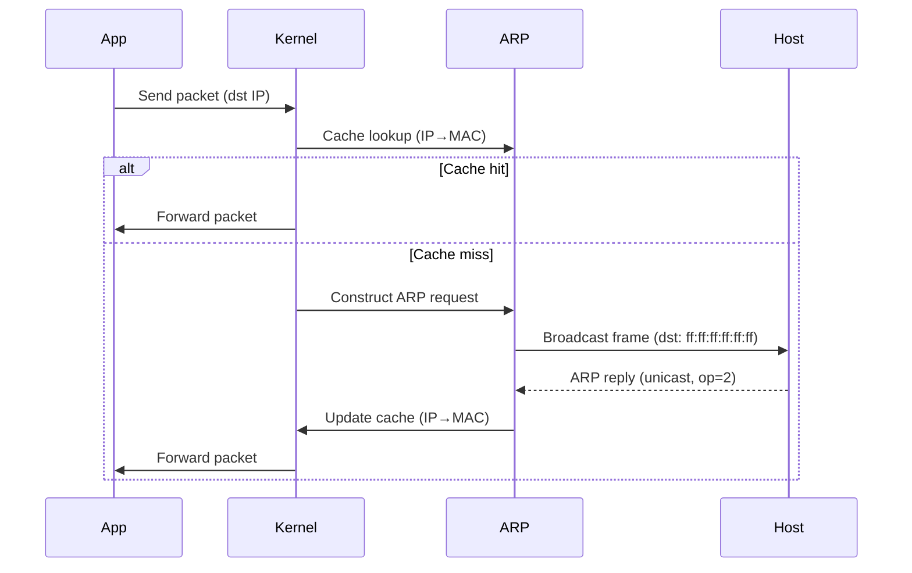

# ARP — Address Resolution Protocol

## What it is
ARP maps a network layer address (IPv4) to a link layer address (MAC) within a local broadcast domain, operating below IP and above the data link framing. It is not routable and has no transport-layer encapsulation.

## Why it matters
Developers encounter ARP when IP connectivity fails within a subnet — e.g., ping succeeds but SSH or API calls fail, or load balancer health checks show intermittent packet loss after VM/IP migration without corresponding ARP cache updates.

## How it actually works
Core resolution lifecycle:
1. **Cache lookup**: Kernel checks existing ARP table for the destination IPv4. A hit delivers the packet immediately; a miss triggers resolution.
2. **Request construction**: An ARP request frame is built with opcode 1, sender hardware/protocol addresses filled, target protocol address set to the desired IP, and target hardware set to the Ethernet broadcast `ff:ff:ff:ff:ff:ff`. The frame's EtherType is `0x0806`.
3. **Broadcast transmission**: The frame is transmitted onto the local medium. All interfaces on the subnet receive it, but only the host owning the target IP processes it.
4. **Reply processing**: The responding host unicasts an ARP reply (opcode 2) containing its own MAC and the requester's IP. The kernel updates the ARP cache and forwards the original packet.
5. **Timeout/retry**: If no reply is received within the host's timeout (typically several seconds), the kernel retries the broadcast, typically up to 3–5 attempts before failing the request.

**Exact byte layout (RFC 826, 28 bytes total, big-endian ordering):**
```text
+--------+--------+----+----+--------+--------+--------+--------+--------+
|   hrd  |   pro  | hln | pln |   op   | sha (6) | spa (4) | tha (6) | tpa (4) |
+--------+--------+----+----+--------+--------+--------+--------+--------+
| 2 bytes| 2 bytes| 1B | 1B | 2 bytes| 6 bytes| 4 bytes| 6 bytes| 4 bytes|
+--------+--------+----+----+--------+--------+--------+--------+--------+
```
Field values (stable, RFC 826):
- **hrd** (Hardware Type): 16-bit big-endian. `1` denotes Ethernet.
- **pro** (Protocol Type): 16-bit big-endian. `0x0800` denotes IPv4.
- **hln** (Hardware Size): 1 byte. Always `6` for MAC addresses.
- **pln** (Protocol Size): 1 byte. Always `4` for IPv4.
- **op** (Opcode): 16-bit big-endian. `1` = Request, `2` = Reply.
- **sha** (Sender Hardware Address): 6 bytes. Sender’s MAC.
- **spa** (Sender Protocol Address): 4 bytes. Sender’s IPv4.
- **tha** (Target Hardware Address): 6 bytes. Zero-filled in request; filled with sender’s MAC in reply.
- **tpa** (Target Protocol Address): 4 bytes. The IPv4 being resolved.

## Architecture / flow
Here is the ARP request/reply lifecycle as a sequence diagram:



## Key terms
- **ARP Cache** — kernel-maintained mapping of IPv4 addresses to MAC addresses, including timestamps for dynamic entry expiry.
- **Gratuitous ARP** — unsolicited ARP reply where sender IP equals target IP, used for conflict detection and cache invalidation.
- **Opcode 1/2** — 16-bit field in ARP frames: `1` requests resolution, `2` replies with a mapping.
- **Cache Timeout** — duration a dynamic ARP entry remains valid before the kernel considers it stale and initiates re-resolution.
- **Broadcast Domain** — logical network segment where ARP requests reach every interface via link-layer broadcast.

## Example
Minimal Python script using [Scapy](https://scapy.net/) to construct and send an ARP request, demonstrating broadcast framing and opcode selection:

```python
from scapy.all import ARP, Ether, srp
pkt = Ether(dst="ff:ff:ff:ff:ff:ff")/ARP(pdst="192.168.1.1", hwdst="ff:ff:ff:ff:ff:ff")
srp(pkt, timeout=2, iface="eth0")
```
This shows an ARP request frame with Ethernet broadcast destination and opcode implicitly set to 1 (request) by Scapy, illustrating how resolution is triggered programmatically.

## Common mistakes
1. **Assuming ARP resolves across routers** — ARP is strictly link-local; no routing mechanism forwards ARP requests beyond the immediate subnet.
2. **Stale static ARP entries after IP migration** — configuring a static IP→MAC mapping without invalidating it causes the kernel to send packets to the old MAC, resulting in silent drops.
3. **Filtering ARP with IP protocol number 0x06** — ARP has no IP header; packet captures must filter on Ethernet type `0x0806`, not IP protocol fields, to capture ARP traffic.
4. **Sending unicast ARP requests without prior resolution** — on multi-access broadcast links, the target MAC is unknown; requests must be broadcast to reach the correct host.

## Lesser-known internals
- **No authentication in ARP replies** — any host on the local subnet can respond with a valid-looking mapping, which is the fundamental enabler of ARP spoofing, cache poisoning, and man-in-the-middle attacks at L2.
- **EtherType 0x0806 is strictly reserved** — IEEE and IANA assignments prevent other protocols from using this value; custom frame crafters that overwrite it cause immediate drops by standards-compliant NICs and switches.
- **Gratuitous ARP as a keepalive** — some OS implementations periodically send gratuitous ARP replies even without address changes, serving as a subtle interface/liveness probe that can trigger cache updates in neighboring hosts.

## Topics to explore further
- **IPv6 Neighbor Discovery (ND)** — replaces ARP for IPv6, using ICMPv6 multicast solicitations and advertisements instead of broadcast, with built-in security via cryptographic extensions.
- **Proxy ARP** — a router answers ARP requests on behalf of remote hosts, enabling transparent IP routing in misconfigured or legacy topologies without explicit gateway changes.
- **Inverse ARP (InARP)** — used in Frame Relay and ATM networks to map Data Link Connection Identifiers (DLCIs) to IP addresses, the inverse of standard ARP’s IP-to-MAC direction.
- **ARP suppression in virtual switches** — Open vSwitch and similar can suppress ARP flooding in dense VM environments, relying on kernel notifiers and flow offloading to reduce L2 control overhead.

## Learn next
- **IPv6 Neighbor Discovery** → evolves ARP concepts for routed, modern networks.
- **Ethernet Switching & Spanning Tree** → ARP operates within L2 domains governed by STP topology and loop prevention.