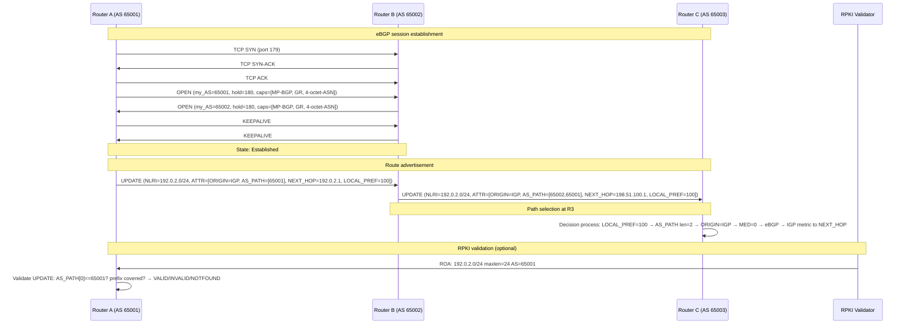

# BGP — Border Gateway Protocol

## What it is
BGP is a **path vector routing protocol** (RFC 4271) that exchanges reachability information between **autonomous systems (ASes)** using TCP port 179. It advertises **NLRI (Network Layer Reachability Information)** paired with **path attributes** — most critically the `AS_PATH` — enabling loop-free inter-domain routing across the global internet. BGP-4 (the only deployed version) supports CIDR, route aggregation, and incremental updates.

## Why it matters
Every production service reachable via the public internet depends on BGP for prefix origination, transit selection, and failover; misconfigurations cause route leaks, hijacks, or blackholes affecting millions of endpoints. Engineers operating anycast, multi-homed infrastructure, or cloud interconnects must understand BGP path selection, community signaling, and session resilience to debug reachability or implement traffic engineering.

## How it actually works

### Protocol fundamentals
- **Transport**: TCP port 179, with MD5 signature option (RFC 2385) or TCP-AO (RFC 5925) for authentication
- **Message types**: `OPEN`, `UPDATE`, `NOTIFICATION`, `KEEPALIVE`, `ROUTE-REFRESH` (RFC 2918)
- **Finite State Machine (FSM)**: `Idle` → `Connect` → `Active` → `OpenSent` → `OpenConfirm` → `Established` (RFC 4271 §8)
- **Hold timer**: Default 180s (min 3s per RFC 4271 §10); `KEEPALIVE` sent at 1/3 hold time
- **Capability negotiation**: Multiprotocol extensions (MP-BGP, RFC 4760), route refresh, 4-octet ASN (RFC 6793), graceful restart (RFC 4724), ADD-PATH (RFC 7911)

### Path attributes (RFC 4271 §5)
| Attribute | Type code | Flags | Description |
|-----------|-----------|-------|-------------|
| `ORIGIN` | 1 | Well-known mandatory | `IGP` (0), `EGP` (1), `INCOMPLETE` (2) |
| `AS_PATH` | 2 | Well-known mandatory | Ordered sequence of ASNs; `AS_SEQUENCE` (1) or `AS_SET` (2) |
| `NEXT_HOP` | 3 | Well-known mandatory | IPv4/IPv6 address of next hop; critical for eBGP→iBGP propagation |
| `MULTI_EXIT_DISC (MED)` | 4 | Optional non-transitive | Inter-AS metric; lower preferred; compared only for same neighbor AS |
| `LOCAL_PREF` | 5 | Well-known discretional | **Highest wins**; default 100; not advertised to eBGP peers |
| `ATOMIC_AGGREGATE` | 6 | Well-known discretional | Indicates information loss from aggregation |
| `AGGREGATOR` | 7 | Optional transitive | ASN + router ID of aggregator |
| `COMMUNITY` | 8 | Optional transitive | 32-bit tag (RFC 1997); `NO_EXPORT` (0xFFFFFF01), `NO_ADVERTISE` (0xFFFFFF02), `NO_EXPORT_SUBCONFED` (0xFFFFFF03) |
| `ORIGINATOR_ID` | 9 | Optional non-transitive | Router ID of route reflector originator (loop prevention) |
| `CLUSTER_LIST` | 10 | Optional non-transitive | Sequence of cluster IDs (route reflector loop prevention) |
| `AS4_PATH` / `AS4_AGGREGATOR` | 17/18 | Optional transitive | 4-octet ASN equivalents (RFC 6793) |

### Path selection algorithm (decision process, RFC 4271 §9.1)
Executed **per-AFI/SAFI** in strict order; first match wins:
1. **Highest `LOCAL_PREF`** (default 100)
2. **Shortest `AS_PATH` length** (counts `AS_SEQUENCE` entries; `AS_SET` counts as 1)
3. **Lowest `ORIGIN` type**: `IGP` (0) < `EGP` (1) < `INCOMPLETE` (2)
4. **Lowest `MED`** (only compared if paths from same neighbor AS; `bgp bestpath med missing-as-worst` modifies)
5. **Prefer eBGP over iBGP** paths
6. **Lowest IGP metric to `NEXT_HOP`** (requires `next-hop-self` or IGP reachability)
7. **Oldest route** (for stability; `bgp bestpath compare-routerid` skips)
8. **Lowest router ID** of advertising peer (or `ORIGINATOR_ID` if reflected)
9. **Shortest `CLUSTER_LIST`** (route reflector)
10. **Lowest neighbor address** (tie-breaker)

**Complexity**: O(N·M) where N = paths per prefix, M = attributes evaluated; typically < 10 paths/prefix in practice.

### eBGP vs iBGP
| Property | eBGP | iBGP |
|----------|------|------|
| Peer AS | Different | Same |
| Default TTL | 1 (directly connected) | 255 |
| `NEXT_HOP` handling | Preserved | Unchanged (requires `next-hop-self` or IGP) |
| `AS_PATH` prepend | Adds local ASN | Not added |
| Loop prevention | `AS_PATH` check | Full mesh / route reflector / confederation |
| `LOCAL_PREF` propagation | No | Yes |
| `MED` propagation | Yes (optional) | Yes |
| Default keepalive/hold | 60/180s | 60/180s |

**iBGP full mesh requirement**: n(n-1)/2 sessions; solved by **route reflectors** (RFC 4456) or **confederations** (RFC 5065). Route reflectors reflect best path only unless `ADD-PATH` (RFC 7911) enabled.

### MP-BGP (RFC 4760)
Carries multiple **AFI/SAFI** pairs over single session:
- AFI 1 (IPv4) / SAFI 1 (unicast), 2 (multicast), 4 (MPLS labels), 128 (VPNv4)
- AFI 2 (IPv6) / SAFI 1, 2, 4, 128 (VPNv6)
- AFI 25 (L2VPN) / SAFI 65 (VPLS), 70 (EVPN)
- Capability advertised in `OPEN` message; `UPDATE` carries `MP_REACH_NLRI` / `MP_UNREACH_NLRI`

### Route refresh & soft reconfiguration
- **Route Refresh** (RFC 2918): Peer re-sends Adj-RIB-Out on request; no local storage overhead
- **Soft-reconfiguration inbound**: Stores received routes pre-policy (memory: O(routes × attributes)); used when peer lacks route refresh support

### Graceful restart (RFC 4724)
- `Restart State` bit in capability; `Forwarding State` bit indicates data plane continuity
- `Restart Time` (max 4095s): peer waits before deleting stale routes
- `Selection Deferral Time`: delays best-path selection after restart
- Requires `LLGR` (Long-Lived Graceful Restart, RFC 8538) for extended stale retention

### BGPsec (RFC 8205)
Cryptographic path validation using **RPKI-signed `BGPsec_Path` attribute** (type 32):
- Each AS signs `(prefix, ASN, subject_key_identifier)` with private key
- Verification requires RPKI validator + router support; deployment < 5% of global table

## Architecture / flow



## Key terms
- **Adj-RIB-In** — Per-neighbor routing table storing routes *received* before import policy applied
- **Adj-RIB-Out** — Per-neighbor routing table storing routes *selected for advertisement* after export policy
- **Loc-RIB** — Local BGP routing table: best paths per prefix after decision process; feeds FIB
- **Route Reflector (RR)** — iBGP node that reflects routes between clients, reducing full-mesh requirement; uses `ORIGINATOR_ID` + `CLUSTER_LIST` for loop prevention
- **Confederation** — Splits AS into sub-ASs (private 4-octet ASNs); eBGP semantics internally, single AS externally; `AS_CONFED_SEQUENCE` / `AS_CONFED_SET` in `AS_PATH`
- **BGP FlowSpec** (RFC 5575) — Encodes traffic filtering rules (match + action) as NLRI; used for DDoS mitigation signaling

## Example
```bash
# FRR (Free Range Routing) config: eBGP + iBGP with route reflector
router bgp 65001
  bgp router-id 1.1.1.1
  neighbor 192.0.2.2 remote-as 65002
  neighbor 192.0.2.2 description eBGP-to-AS65002
  neighbor 192.0.2.2 password s3cr3t
  neighbor 192.0.2.2 bfd
  neighbor 192.0.2.2 capability extended-nexthop
  !
  neighbor 10.0.0.2 remote-as 65001
  neighbor 10.0.0.2 description iBGP-to-RR-client
  neighbor 10.0.0.2 update-source lo0
  neighbor 10.0.0.2 route-reflector-client
  neighbor 10.0.0.2 send-community extended
  !
  address-family ipv4 unicast
    network 192.0.2.0/24
    neighbor 192.0.2.2 activate
    neighbor 192.0.2.2 route-map SET_MED_OUT out
    neighbor 10.0.0.2 activate
    neighbor 10.0.0.2 next-hop-self
  exit-address-family
!
route-map SET_MED_OUT permit 10
  set metric 100
```
Demonstrates eBGP peering with MD5/TCP-AO auth, BFD, extended next-hop for IPv6-over-IPv4, iBGP route reflector client with `next-hop-self`, and outbound MED policy.

## Common mistakes
1. **Forgetting `next-hop-self` on iBGP** — `NEXT_HOP` from eBGP peer remains unchanged; if IGP lacks route to that address, traffic blackholes despite valid BGP path
2. **Assuming MED compares across neighbor ASes** — MED only compared for paths from *same* adjacent AS; use `bgp bestpath med confed` for confederations or communities for cross-AS TE
3. **Disabling `AS_PATH` loop check on route reflectors** — `bgp allow-as-in` on RR clients causes loops; use `ORIGINATOR_ID`/`CLUSTER_LIST` instead
4. **Configuring `maximum-paths` without `bgp bestpath as-path multipath-relax`** — Default requires identical `AS_PATH`; `multipath-relax` allows different AS_PATHs of equal length (RFC 8277)

## Lesser-known internals
- **BGP decision process re-runs on IGP metric change** — If `NEXT_HOP` IGP cost changes, BGP re-evaluates step 6 *without* peer notification; can cause micro-loops if IGP converges faster than BGP
- **`ADD-PATH` Tx mode vs Rx mode** — `neighbor X capability additional-paths send/receive` independent; sender can advertise *k* best paths (configurable), receiver must support `MP_REACH_NLRI` with path identifiers (4-octet)
- **TCP MSS clamping critical for BGP** — Large `UPDATE` messages (full table ~1M prefixes) exceed path MTU; `ip tcp adjust-mss 1360` (IPv4) or `ipv6 tcp adjust-mss 1340` prevents PMTUD blackholes on session establishment

## Topics to explore further
- **EVPN (RFC 7432)** — BGP MP-BGP AFI 25 SAFI 70 for L2VPN/L3VPN with MAC/IP advertisement, ARP/ND suppression, and multi-homing via ESI
- **BGP-LS (RFC 7752)** — Link-State distribution via BGP (AFI 16388/16389) for SDN controller topology visibility
- **FlowSpec validation (RFC 5575 §6)** — Strict validation rules to prevent filter injection attacks; `traffic-rate` action encoding specifics

## Learn next
- **RPKI / ROA validation** — Cryptographic prefix-origin authorization; directly secures BGP `AS_PATH` trust model
- **Segment Routing (SR-MPLS / SRv6)** — Uses BGP-LS / BGP-CT for path computation; replaces LDP/RSVP-TE, integrates with BGP next-hop resolution
- **BGP FlowSpec / DDoS mitigation** — Operationalizes BGP for real-time traffic filtering; requires careful validation deployment