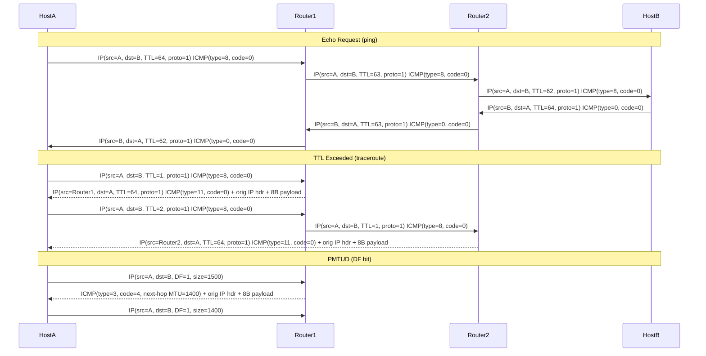

# ICMP Protocol

## What it is
ICMP (Internet Control Message Protocol) is a network-layer protocol (IP protocol number 1) used by hosts and routers to communicate error conditions, operational information, and diagnostic signals about IP packet processing. It is integral to IP (RFC 792 for IPv4, RFC 4443 for IPv6) and does not use transport-layer ports — messages are identified by **type** and **code** fields within the ICMP header.

## Why it matters
Every IP implementation must process ICMP to handle unreachable destinations, TTL expiration, fragmentation failures, and path MTU discovery; blocking ICMP indiscriminately breaks connectivity diagnostics, MTU negotiation, and TCP performance.

## How it actually works
ICMP messages are encapsulated directly in IP packets (protocol=1 for IPv4, Next Header=58 for IPv6). The ICMP header is **8 bytes minimum**: 1 byte **type**, 1 byte **code**, 2 bytes **checksum** (Internet checksum per RFC 1071), and 4 bytes **rest-of-header** (varies by type). The payload includes the original IP header + first 8 bytes of the original payload (RFC 1122 §3.2.2) to allow the sender to associate the error with a specific socket/connection.

### IPv4 ICMP Message Types (RFC 792, RFC 1122)
| Type | Code | Name | Purpose |
|------|------|------|---------|
| 0 | 0 | Echo Reply | Response to Echo Request |
| 3 | 0-15 | Destination Unreachable | Network/host/port/protocol/fragmentation unreachable |
| 4 | 0 | Source Quench | Deprecated (congestion control) |
| 5 | 0-3 | Redirect | Router suggests better next-hop |
| 8 | 0 | Echo Request | Ping / reachability test |
| 11 | 0-1 | Time Exceeded | TTL=0 in transit (0) or fragment reassembly timeout (1) |
| 12 | 0-1 | Parameter Problem | Malformed IP header |
| 13/14 | 0 | Timestamp/Reply | Time synchronization (rarely used) |
| 17/18 | 0 | Address Mask Request/Reply | Subnet mask discovery (obsolete) |

### IPv6 ICMPv6 Types (RFC 4443)
| Type | Code | Name |
|------|------|------|
| 1 | 0-3 | Destination Unreachable |
| 2 | 0 | Packet Too Big (includes MTU) |
| 3 | 0-1 | Time Exceeded |
| 4 | 0-2 | Parameter Problem |
| 128 | 0 | Echo Request |
| 129 | 0 | Echo Reply |
| 130-131 | - | MLD (Multicast Listener Discovery) |
| 133-137 | - | NDP (Neighbor Discovery Protocol) |

### Checksum Calculation
The **Internet checksum** (RFC 1071): 16-bit one's complement sum of the entire ICMP message (header + payload) with the checksum field zeroed. Computed over 16-bit words; odd-length messages padded with a zero byte. Result is one's complement of the sum.

### TTL Exceeded Mechanism
Each router decrements IPv4 **TTL** (or IPv6 **Hop Limit**) by 1 before forwarding. When it reaches 0, the packet is discarded and the router sends **ICMP Time Exceeded (type 11, code 0)** to the source IP. This is how `traceroute` discovers the path: it sends packets with incrementing TTL (1, 2, 3...) and collects the ICMP errors.

### Destination Unreachable Codes (Type 3)
- **Code 0**: Network unreachable
- **Code 1**: Host unreachable
- **Code 2**: Protocol unreachable (no handler for IP protocol number)
- **Code 3**: Port unreachable (no listener on UDP/TCP port) — **critical for UDP server discovery**
- **Code 4**: Fragmentation needed but DF bit set — **enables Path MTU Discovery (RFC 1191, RFC 8899)**
- **Code 13**: Communication administratively prohibited (firewall)

### Redirect (Type 5)
Sent by a router when a host uses a suboptimal next-hop. Codes: 0=network, 1=host, 2=network+TOS, 3=host+TOS. Hosts **should** update their routing cache (RFC 1122 §3.2.2.2), but many ignore redirects for security.

### Rate Limiting (RFC 1122 §3.2.2, RFC 4443 §2.4)
Hosts and routers **must** rate-limit ICMP error messages to avoid broadcast storms. Typical implementation: token bucket (e.g., Linux `net.ipv4.icmp_ratelimit` = 1000ms default, `icmp_ratemask` bitmask of allowed types). Echo Request/Reply are often exempt or have separate limits.

### Path MTU Discovery (PMTUD)
Sender sets **DF (Don't Fragment)** bit. If a router cannot forward without fragmentation, it drops the packet and sends **ICMP Type 3 Code 4 (Packet Too Big in IPv6)** containing the **next-hop MTU** in the unused 16 bits of the ICMP header (bytes 6-7). Sender reduces path MTU and retransmits. **Blocking this ICMP breaks PMTUD**, causing silent connection hangs for large packets.

### Raw Socket API
ICMP requires raw sockets (`SOCK_RAW`, `IPPROTO_ICMP` / `IPPROTO_ICMPV6`). On Linux: `socket(AF_INET, SOCK_RAW, IPPROTO_ICMP)` requires `CAP_NET_RAW`. The kernel handles checksum calculation if `IP_HDRINCL` is not set; otherwise application must compute. Received ICMP packets include the IP header only if `IP_HDRINCL` or via `IP_RECVERR`/`IPV6_RECVERR`.

## Architecture / flow


## Key terms
**Internet checksum** — 16-bit one's complement sum over ICMP header+payload; used for ICMP, IP, UDP, TCP headers.
**Type/Code** — 8-bit fields identifying ICMP message class and subclass; replaces port-based demultiplexing.
**DF bit** — Don't Fragment flag in IPv4 header (bit 6); when set, routers must not fragment and must send ICMP Type 3 Code 4.
**PMTUD** — Path MTU Discovery; relies on ICMP Packet Too Big / Fragmentation Needed to learn path MTU.
**ICMP rate limiting** — Token-bucket or fixed-window limit on ICMP error generation to prevent amplification attacks.
**Original datagram payload** — First 8 bytes of original IP payload (includes UDP/TCP ports) included in ICMP error for demultiplexing.

## Example
```bash
# Capture ICMPv4 echo request/reply with tcpdump (verbose, show ICMP type/code)
tcpdump -ni eth0 -v 'icmp[icmptype] == icmp-echo or icmp[icmptype] == icmp-echoreply'
# Output shows: IP A > B: ICMP echo request, id 0x1234, seq 1, length 64
#               IP B > A: ICMP echo reply, id 0x1234, seq 1, length 64
```
Demonstrates filtering by ICMP type (8=echo request, 0=echo reply) and viewing identifier/sequence fields used to match requests to replies.

## Common mistakes
- **Blocking all ICMP** at firewalls — breaks PMTUD (Type 3 Code 4), traceroute (Type 11), and UDP port-unreachable signaling (Type 3 Code 3).
- **Assuming ICMP uses ports** — it uses type/code; `iptables -p icmp --dport 8` is invalid syntax (use `--icmp-type 8`).
- **Ignoring rate limits** — sending high-rate pings triggers kernel ICMP rate limiting (`icmp_ratelimit`), causing apparent packet loss that isn't network congestion.
- **Not validating ICMP payload** — accepting ICMP errors without verifying the embedded original IP header + 8 bytes matches an active socket enables off-path injection attacks (RFC 5927).

## Lesser-known internals
- **ICMP identifier/sequence** in Echo Request/Reply (bytes 4-7 of ICMP payload) are **not** ports — they are 16-bit values chosen by the sender (typically PID for identifier, incrementing counter for sequence) to match replies to requests across multiple concurrent pings.
- **IPv6 Packet Too Big (Type 2)** includes the **MTU in bytes 4-7** of the ICMP message (unlike IPv4 Type 3 Code 4 where MTU is in bytes 6-7 of the ICMP header); this is why IPv6 PMTUD works without DF bit — IPv6 routers never fragment.
- **Linux `ping` uses `SO_TIMESTAMPING` + `SOCK_DGRAM` with `IPPROTO_ICMP`** (not raw sockets) since kernel 2.6.39 — it lets the kernel handle checksum and identifier allocation, avoiding `CAP_NET_RAW` requirement for unprivileged ping (via `ping_group_range` sysctl).

## Topics to explore further
- **ICMPv6 Neighbor Discovery Protocol (NDP)** — replaces ARP, router discovery, and address autoconfiguration; uses ICMPv6 types 133-137.
- **ICMP extensions for MPLS (RFC 4950)** — carries label stack information in ICMP payload for LSP ping/traceroute.
- **ICMP rate-limiting algorithms** — token bucket vs. leaky bucket implementations across OS kernels (Linux `icmp_ratelimit`/`icmp_ratemask`, BSD `net.inet.icmp.icmplim`).
- **ICMP-based covert channels** — embedding data in identifier/sequence/payload fields; detection via entropy analysis of echo traffic.

## Learn next
- **IPv4/IPv6 header structure** — ICMP is encapsulated in IP; understanding TTL/Hop Limit, DF bit, Next Header, and fragmentation fields is essential for interpreting ICMP behavior.
- **UDP/TCP interaction with ICMP** — how ICMP errors (port unreachable, fragmentation needed) affect socket state, retransmission timers, and PMTUD black holes.
- **Raw socket programming** — `SOCK_RAW` with `IPPROTO_ICMP`/`IPPROTO_ICMPV6` for building custom ping, traceroute, or protocol validators.