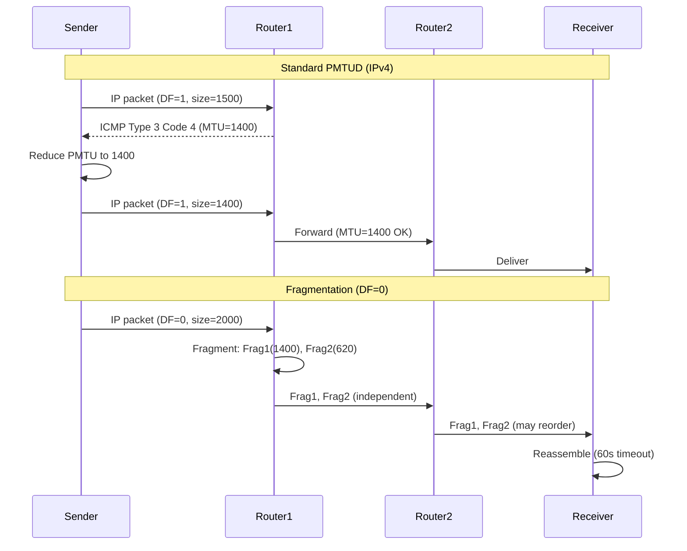

# IP Fragmentation & MTU

## What it is
IP fragmentation is the process of splitting an IP datagram into smaller pieces (fragments) when its size exceeds the **Maximum Transmission Unit (MTU)** of a network link. Each fragment becomes an independent IP packet with its own header, reassembled only at the final destination. MTU is the largest packet size a given link-layer technology can transmit without fragmentation (e.g., 1500 bytes for standard Ethernet).

## Why it matters
Fragmentation increases CPU overhead, latency, and packet loss probability (losing one fragment discards the entire datagram). Path MTU Discovery (PMTUD) avoids fragmentation by learning the minimum MTU along a path, but relies on ICMP which is often blocked, causing "black hole" connections where large packets silently fail.

## How it actually works

### IPv4 Fragmentation (RFC 791)
The IPv4 header contains three fields for fragmentation:
- **Identification (16-bit)**: Unique per (source, destination, protocol) tuple for the datagram's lifetime. All fragments share this value.
- **Flags (3-bit)**: Bit 0 = Reserved (must be 0), Bit 1 = **DF (Don't Fragment)**, Bit 2 = **MF (More Fragments)**. DF=1 prohibits fragmentation; if MTU exceeded, router drops packet and sends ICMP Type 3 Code 4 (Destination Unreachable, Fragmentation Needed). MF=1 indicates more fragments follow; MF=0 marks the last fragment.
- **Fragment Offset (13-bit)**: Offset of this fragment's data relative to the original datagram, in **8-byte units**. Maximum offset = 8191 × 8 = 65,528 bytes. Combined with max payload (65,535 - 20 header = 65,515), theoretical max datagram = 65,535 bytes.

**Fragmentation algorithm** (router or sender):
1. If DF=0 and packet size > outgoing link MTU, split payload into chunks of size ≤ (MTU - IP header size).
2. Each chunk gets a new IP header: same Identification, same protocol, TTL decremented, MF=1 for all but last, Fragment Offset = previous offset + (previous payload length / 8).
3. Header checksum recalculated per fragment.
4. Fragments routed independently; may arrive out of order.

**Reassembly** (destination host only):
- Buffer fragments by (Identification, Source, Destination, Protocol).
- Timeout: **60 seconds** (RFC 791 recommended); Linux default `net.ipv4.ipfrag_time` = 30s.
- Reassemble when all offsets 0..N contiguous with MF=0 on last fragment.
- Maximum reassembly buffer: **576 bytes** minimum required (RFC 791), typically 64 KB in modern OS.

### IPv6 Fragmentation (RFC 8200)
- **Routers never fragment**. Only source nodes fragment.
- If packet > path MTU, router drops and sends **ICMPv6 Type 2 Code 0 (Packet Too Big)** with MTU field.
- Fragmentation uses **Fragment Extension Header** (Next Header = 44):
  - Next Header (8-bit): Header type following this extension
  - Reserved (8-bit): 0
  - Fragment Offset (13-bit): Same 8-byte units
  - Reserved (2-bit): 0
  - M flag (1-bit): More fragments (1 = more, 0 = last)
  - Reserved (1-bit): 0
  - Identification (32-bit): Per-datagram unique value (vs 16-bit in IPv4)
- Minimum IPv6 MTU: **1280 bytes** (RFC 8200). Hosts must reassemble up to 1500 bytes; recommended 1500+.

### Path MTU Discovery (PMTUD)
- **RFC 1191 (IPv4)**, **RFC 8201 (IPv6)**: Sender sets DF=1 (IPv4) or relies on ICMPv6 Packet Too Big (IPv6).
- On ICMP "Packet Too Big" (IPv4 Type 3 Code 4 with Next-Hop MTU field; IPv6 Type 2 Code 0 with MTU field), sender reduces path MTU estimate.
- **PLPMTUD (RFC 8899)**: Probe-based (no ICMP reliance). Sender transmits probe packets of increasing size with DF=1; loss indicates MTU exceeded. Used by QUIC, TCP (Linux `net.ipv4.tcp_mtu_probing=2`).

### MTU Values
| Link Layer | MTU (bytes) |
|------------|-------------|
| Ethernet (802.3) | 1500 |
| Ethernet + 802.1Q (VLAN) | 1500 (1522 on wire) |
| PPPoE | 1492 |
| IPv6 minimum | 1280 |
| IPv4 minimum reassembly | 576 |
| Jumbo frames | 9000 (common) |

## Architecture / flow



## Key terms
**DF bit (Don't Fragment)** — IPv4 header flag (bit 1 of Flags) prohibiting fragmentation; triggers ICMP Type 3 Code 4 if MTU exceeded.
**Fragment Offset** — 13-bit field in IPv4/IPv6 fragment header specifying data offset in 8-byte units; max value 8191.
**MF bit (More Fragments)** — IPv4 header flag (bit 2 of Flags) set on all fragments except the last; IPv6 uses M flag in Fragment Extension Header.
**PMTUD (Path MTU Discovery)** — Mechanism (RFC 1191/8201) where sender learns path MTU via ICMP "Packet Too Big" messages with DF=1 packets.
**PLPMTUD (Packetization Layer PMTUD)** — Probe-based PMTUD (RFC 8899) avoiding ICMP dependency; used by QUIC and modern TCP stacks.
**Reassembly timeout** — Maximum time destination holds fragments awaiting completion; IPv4 default 60s (RFC 791), Linux 30s (`net.ipv4.ipfrag_time`).

## Example
```bash
# Linux: Enable TCP MTU probing (PLPMTUD) and view PMTU cache
sysctl -w net.ipv4.tcp_mtu_probing=2
ip route show cache  # Shows learned PMTU per destination

# IPv4: Send DF=1 packet of specific size to test PMTU
ping -M do -s 1472 192.0.2.1  # 1472 + 28 headers = 1500

# IPv6: Minimum MTU 1280, test with ping6
ping6 -s 1232 2001:db8::1  # 1232 + 48 headers = 1280
```
Demonstrates PLPMTUD activation, PMTU cache inspection, and manual MTU testing with DF bit set.

## Common mistakes
1. **Assuming ICMP is always allowed** — Firewalls blocking ICMP Type 3 Code 4 (IPv4) or Type 2 Code 0 (IPv6) break PMTUD, causing silent failures for packets > path MTU (TCP connections hang on large writes).
2. **Setting MSS incorrectly** — TCP MSS = MTU - 40 (IPv4) or -60 (IPv6). Hardcoding 1460 ignores tunnels (PPPoE 1452, IPsec ~1380, WireGuard ~1420). Use `TCP_MAXSEG` or `IP_MTU_DISCOVER` socket options.
3. **Fragmenting at sender with DF=0** — Shifts reassembly burden to receiver; increases loss rate (1 fragment lost = whole datagram lost) and enables fragmentation attacks (overlapping fragments, tiny fragment DoS).
4. **Ignoring IPv6 minimum MTU** — Sending IPv6 packets >1280 bytes without PMTUD violates RFC 8200; some paths (e.g., 6to4, Teredo) have MTU <1500.

## Lesser-known internals
- **IPv4 Identification field wrap**: 16-bit ID wraps at 65,536 datagrams. High-rate flows can reuse IDs before fragments expire, causing mis-reassembly. Linux mitigates via `net.ipv4.ipfrag_max_dist` (default 64) limiting fragment reordering distance.
- **ICMP MTU field in IPv4**: RFC 1191 defines "Next-Hop MTU" in low 16 bits of ICMP Type 3 Code 4 unused field. Not all implementations populate it; Linux reads it via `IP_PMTUDISC_DO` socket option.
- **Fragment overlapping attack**: Sending fragments with overlapping offsets but different payloads exploits ambiguous reassembly policies (RFC 5722). Modern stacks (Linux, BSD) reject overlaps by default (`net.ipv4.ipfrag_overlap=0`).

## Topics to explore further
- **IPsec ESP overhead and MTU** — ESP adds 38-58 bytes (tunnel mode), requiring MSS clamping or PMTUD tuning on VPN endpoints.
- **Jumbo frames and data center MTU** — 9000-byte MTU reduces CPU/interrupts for storage/ML traffic; requires end-to-end switch/config coordination.
- **QUIC packetization and PLPMTUD** — QUIC implements RFC 8899 natively; manages packet size per path, not per connection, with probe packets.

## Learn next
- **TCP MSS Clamping & Window Scaling** — Directly interacts with PMTUD; MSS negotiation happens at SYN, but PMTUD may reduce effective MTU post-handshake.
- **ICMP Filtering & Network Diagnostics** — Understanding which ICMP types/codes are required for PMTUD vs. security hardening.
- **IPv6 Extension Headers Processing** — Fragment Extension Header is one of several; ordering and parsing rules affect performance and security.