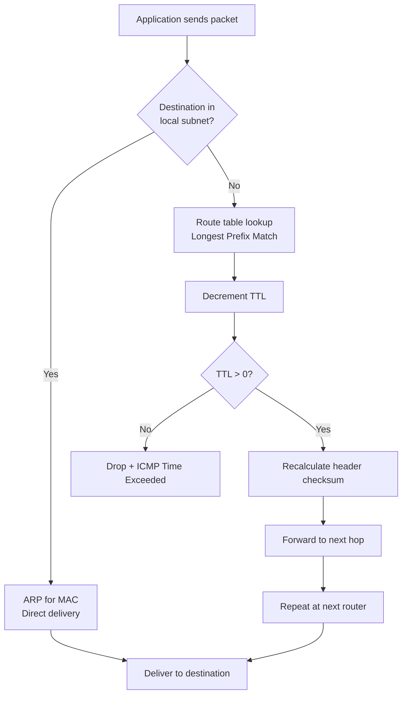

# IPv4 Addressing Deep Dive

## What it is
IPv4 addressing is a 32-bit numerical identifier assigned to network interfaces, represented in dotted-decimal notation (four octets separated by periods). Each address consists of a network prefix and a host identifier, with the boundary defined by a subnet mask or CIDR prefix length. The address space totals 2^32 (4,294,967,296) unique addresses.

## Why it matters
Every networked application — from container orchestration to microservice discovery — ultimately resolves to IPv4 routing decisions; misconfigured subnets, overlapping CIDR blocks, or exhausted private ranges cause silent connectivity failures that manifest as timeouts, not errors.

## How it actually works

### Binary representation and structure
An IPv4 address is a 32-bit unsigned integer. Dotted-decimal notation splits the 32 bits into four 8-bit octets, each converted to decimal (0-255). Example: `192.168.1.10` = `11000000.10101000.00000001.00001010` = `0xC0A8010A` = `3232235786`.

The **network prefix** (most significant bits) identifies the network; the **host identifier** (least significant bits) identifies the interface within that network. The division point is defined by:
- **Subnet mask**: 32-bit value with contiguous leading 1s (network) and trailing 0s (host). Example: `255.255.255.0` = `/24` = 24 network bits, 8 host bits.
- **CIDR notation**: `/n` where `n` = number of network bits (0-32).

Network address = IP address AND subnet mask (bitwise). Broadcast address = network address OR (NOT subnet mask). Usable host range = network address + 1 through broadcast address - 1.

### Classful addressing (historical, informs current defaults)
Defined in RFC 791 (1981), deprecated by RFC 4632 (CIDR, 1993) but still determines default masks:

| Class | First Octet Range | Leading Bits | Default Mask | CIDR | Network Bits | Host Bits | Networks | Hosts/Network |
|-------|-------------------|--------------|--------------|------|--------------|-----------|----------|---------------|
| A     | 1-126             | `0`          | 255.0.0.0    | /8   | 8            | 24        | 126      | 16,777,214    |
| B     | 128-191           | `10`         | 255.255.0.0  | /16  | 16           | 16        | 16,384   | 65,534        |
| C     | 192-223           | `110`        | 255.255.255.0| /24  | 24           | 8         | 2,097,152| 254           |
| D     | 224-239           | `1110`       | N/A          | N/A  | N/A          | N/A       | N/A      | N/A (multicast)|
| E     | 240-255           | `1111`       | N/A          | N/A  | N/A          | N/A       | N/A      | N/A (reserved)|

Class A: `0.0.0.0/8` reserved (current network), `127.0.0.0/8` loopback. Class D: `224.0.0.0/4` multicast. Class E: `240.0.0.0/4` reserved for future use.

### CIDR and VLSM (RFC 4632, RFC 1812)
Classless Inter-Domain Routing eliminates class boundaries. Any prefix length `/0` through `/32` is valid. **Variable Length Subnet Masking (VLSM)** allows recursive subnetting within a block. Example: `10.0.0.0/8` → `10.0.0.0/16` → `10.0.1.0/24` → `10.0.1.0/26`.

**Longest Prefix Match (LPM)** routing: routers select the route with the most specific (longest) matching prefix. Time complexity: O(W) where W = address width (32 for IPv4) using binary trie; hardware TCAM achieves O(1).

### Private address ranges (RFC 1918)
Non-routable on public internet; used internally with NAT (RFC 3022):

| Range | CIDR | Addresses | Classful Equivalent |
|-------|------|-----------|---------------------|
| 10.0.0.0 - 10.255.255.255 | 10.0.0.0/8 | 16,777,216 | Single Class A |
| 172.16.0.0 - 172.31.255.255 | 172.16.0.0/12 | 1,048,576 | 16 Class B |
| 192.168.0.0 - 192.168.255.255 | 192.168.0.0/16 | 65,536 | 256 Class C |

### Special-use addresses (RFC 5735, RFC 6890)
- `0.0.0.0/8`: "This network" (source only, DHCP)
- `127.0.0.0/8`: Loopback (127.0.0.1 standard)
- `169.254.0.0/16`: Link-local (APIPA, RFC 3927)
- `224.0.0.0/4`: Multicast (Class D)
- `240.0.0.0/4`: Reserved (Class E)
- `255.255.255.255/32`: Limited broadcast

### Subnet calculations
Given IP `192.168.1.100/26`:
- Mask: `255.255.255.192` (26 ones)
- Network: `192.168.1.64` (100 & 192 = 64)
- Broadcast: `192.168.1.127` (64 | 63 = 127)
- Usable: `192.168.1.65` - `192.168.1.126` (62 hosts)
- Block size: 2^(32-26) = 64 addresses per subnet

**Subnetting formula**: Borrow `n` host bits → 2^n subnets, 2^(h-n) - 2 usable hosts per subnet (h = original host bits).

### Header format (RFC 791)
```
 0                   1                   2                   3
 0 1 2 3 4 5 6 7 8 9 0 1 2 3 4 5 6 7 8 9 0 1 2 3 4 5 6 7 8 9 0 1
+-+-+-+-+-+-+-+-+-+-+-+-+-+-+-+-+-+-+-+-+-+-+-+-+-+-+-+-+-+-+-+-+
|Version|  IHL  |Type of Service|          Total Length         |
+-+-+-+-+-+-+-+-+-+-+-+-+-+-+-+-+-+-+-+-+-+-+-+-+-+-+-+-+-+-+-+-+
|         Identification        |Flags|      Fragment Offset    |
+-+-+-+-+-+-+-+-+-+-+-+-+-+-+-+-+-+-+-+-+-+-+-+-+-+-+-+-+-+-+-+-+
|  Time to Live |    Protocol   |         Header Checksum       |
+-+-+-+-+-+-+-+-+-+-+-+-+-+-+-+-+-+-+-+-+-+-+-+-+-+-+-+-+-+-+-+-+
|                       Source Address (32-bit)                 |
+-+-+-+-+-+-+-+-+-+-+-+-+-+-+-+-+-+-+-+-+-+-+-+-+-+-+-+-+-+-+-+-+
|                    Destination Address (32-bit)               |
+-+-+-+-+-+-+-+-+-+-+-+-+-+-+-+-+-+-+-+-+-+-+-+-+-+-+-+-+-+-+-+-+
|                    Options (if IHL > 5)                       |
+-+-+-+-+-+-+-+-+-+-+-+-+-+-+-+-+-+-+-+-+-+-+-+-+-+-+-+-+-+-+-+-+
```
- **Version**: 4 (4 bits)
- **IHL**: Internet Header Length in 32-bit words (min 5 = 20 bytes, max 15 = 60 bytes)
- **Total Length**: Entire packet length in bytes (max 65,535)
- **TTL**: Hop limit (decremented per router; 0 = discard, ICMP Time Exceeded)
- **Protocol**: Next header (TCP=6, UDP=17, ICMP=1, etc. — IANA assigned)

## Architecture / flow



## Key terms
**CIDR** — Classless Inter-Domain Routing; variable-length prefix notation `/n` replacing classful boundaries.
**VLSM** — Variable Length Subnet Masking; recursive subnetting of a block into smaller subnets of different sizes.
**LPM** — Longest Prefix Match; routing algorithm selecting the most specific matching route.
**RFC 1918** — Defines three private IPv4 ranges (10/8, 172.16/12, 192.168/16) non-routable on public internet.
**Network address** — Result of IP AND subnet mask; identifies the subnet, not assignable to a host.
**Broadcast address** — All host bits set to 1; delivers to all hosts in the subnet (directed broadcast).

## Example
```bash
# Calculate subnet details for 172.16.45.78/20
ipcalc 172.16.45.78/20
# Output:
# Address:   172.16.45.78          10101100.00010000.0010 1101.01001110
# Netmask:   255.255.240.0 = 20    11111111.11111111.1111 0000.00000000
# Network:   172.16.32.0           10101100.00010000.0010 0000.00000000
# Broadcast: 172.16.47.255         10101100.00010000.0010 1111.11111111
# HostMin:   172.16.32.1
# HostMax:   172.16.47.254
# Hosts/Net: 4094                   (2^(32-20) - 2)
```
Demonstrates CIDR block calculation: /20 yields 4096 addresses (4094 usable), network boundary at 172.16.32.0.

## Common mistakes
- **Assuming /24 default for 10.x.x.x**: 10.0.0.0/8 is Class A default; using /24 wastes 254x address space unless intentionally subnetted.
- **Using 172.16.0.0/16 as "the" private B range**: RFC 1918 defines 172.16.0.0/12 (172.16.0.0 – 172.31.255.255); 172.16.0.0/16 is only one of 16 possible /16s.
- **Forgetting network/broadcast addresses are unusable**: A /30 (4 addresses) yields only 2 usable hosts (point-to-point links); /31 (2 addresses) is valid for p2p per RFC 3021 with no broadcast.
- **Overlapping CIDR blocks in VPC peering**: 10.0.0.0/16 and 10.0.0.0/24 cannot peer; LPM breaks routing symmetry.

## Lesser-known internals
- **/31 subnets (RFC 3021)**: Valid for point-to-point links; no network/broadcast addresses — both IPs usable. Supported on Linux, Cisco, Juniper; not on all embedded stacks.
- **Subnet zero and all-ones subnet**: Historically forbidden (RFC 950), permitted since RFC 1812. Modern stacks allow `192.168.1.0/24` and `192.168.1.128/25` as valid subnets of `192.168.1.0/24`.
- **IPv4-mapped IPv6 addresses**: `::ffff:192.168.1.1` (::ffff:0:0/96) enables dual-stack sockets; kernel synthesizes IPv4 header from IPv6 socket API calls.

## Topics to explore further
- **IPv6 addressing architecture** — 128-bit space, SLAAC, privacy extensions, no broadcast (multicast only)
- **NAT variants** — NAT44 (RFC 3022), NAPT, NAT64/DNS64, carrier-grade NAT (RFC 6598 100.64.0.0/10)
- **BGP routing** — AS paths, route aggregation, CIDR's role in reducing global table size
- **IP fragmentation/reassembly** — MTU discovery (RFC 1191), DF bit, ICMP Packet Too Big, security implications

## Learn next
- **IPv6 Addressing** — Direct successor addressing IPv4 exhaustion; 128-bit space, different subnet model, no NAT requirement
- **Subnet Routing & LPM** — How routers actually forward packets; trie/TCAM implementation, ECMP, policy routing
- **NAT & Connection Tracking** — Stateful translation mechanics, port allocation algorithms, hairpin NAT, timeout behaviors