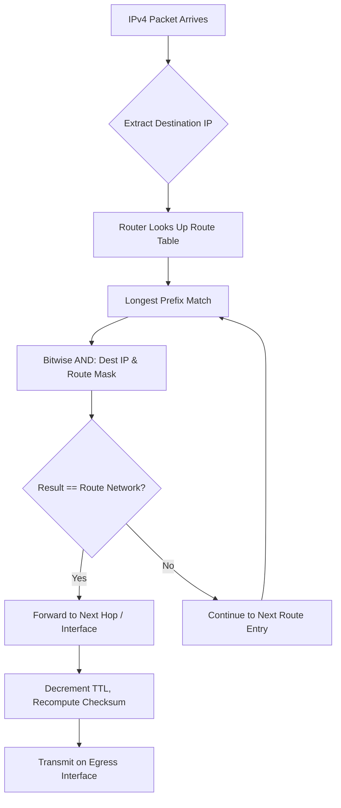

# IPv4 Subnetting

## What it is
IPv4 subnetting is the process of dividing a single IPv4 network into multiple smaller logical networks by borrowing bits from the host portion of an address to create a subnet identifier. A subnet mask (or CIDR prefix length) defines the boundary between network and host bits, enabling routers to determine whether a destination is local or remote via bitwise AND operations.

## Why it matters
Developers encounter subnetting when configuring container networking, cloud VPCs, Kubernetes pod CIDRs, firewall rules, and load balancer health checks — misconfigured masks cause silent connectivity failures, IP exhaustion, or security gaps from overly broad allow-lists.

## How it actually works
An IPv4 address is a 32-bit unsigned integer. The subnet mask is a 32-bit value with contiguous leading 1s (network bits) followed by contiguous 0s (host bits). CIDR notation `/n` indicates `n` network bits. The network address is computed as `address & mask`. The broadcast address is `network | ~mask`. Usable host count is `2^(32-n) - 2` (subtracting network and broadcast addresses).

**Key RFCs**: RFC 791 (IPv4), RFC 950 (subnetting), RFC 1878 (variable length subnet masks), RFC 4632 (CIDR), RFC 1918 (private addresses).

**Binary mechanics**:
- Mask `/24` = `255.255.255.0` = `11111111.11111111.11111111.00000000`
- Address `192.168.1.130` & Mask `255.255.255.0` = Network `192.168.1.0`
- Host bits = 8 → 256 total, 254 usable (`2^8 - 2`)

**Subnet calculation algorithm** (given network `N/m` and required subnets `k`):
1. Find smallest `s` where `2^s >= k`
2. New prefix = `m + s` (must be ≤ 30 for point-to-point, ≤ 31 per RFC 3021)
3. Subnet increment = `2^(32 - new_prefix)`
4. Subnet `i` network = `N + (i * increment)`

**VLSM**: Variable Length Subnet Masking allows different prefix lengths within the same parent network. Requires routing protocols supporting CIDR (OSPF, IS-IS, BGP, RIPv2, EIGRP) — not RIPv1 or IGRP.

**Private ranges (RFC 1918)**:
- `10.0.0.0/8` (16,777,216 addresses)
- `172.16.0.0/12` (1,048,576 addresses)
- `192.168.0.0/16` (65,536 addresses)

**Special prefixes**:
- `/31` — point-to-point links (RFC 3021), no network/broadcast, 2 usable
- `/32` — single host (loopback, host routes)
- `/0` — default route `0.0.0.0/0`

## Architecture / flow


## Key terms
**CIDR** — Classless Inter-Domain Routing; notation `/n` specifying prefix length, replacing classful A/B/C boundaries.
**Longest Prefix Match** — Routing algorithm selecting the route with the most specific (longest) matching network prefix.
**Network Address** — First address in a subnet (host bits all 0); not assignable to interfaces.
**Broadcast Address** — Last address in a subnet (host bits all 1); used for local-link broadcast, not forwarded by routers.
**VLSM** — Variable Length Subnet Masking; using multiple prefix lengths within one parent network for efficient allocation.
**RFC 1918** — Defines three private IPv4 ranges non-routable on public internet, requiring NAT for external connectivity.

## Example
```bash
# Calculate subnets for 10.0.0.0/16 into /24s
ipcalc 10.0.0.0/16 --split 256
# Output shows 256 subnets: 10.0.0.0/24 through 10.0.255.0/24
# Each has 254 usable hosts (10.x.y.1 - 10.x.y.254)
```

## Common mistakes
- **Using `/24` everywhere** — wastes addresses in point-to-point links; use `/31` (RFC 3021) or `/30` for router interconnects.
- **Forgetting `-2` for usable hosts** — `/24` has 256 total IPs but only 254 assignable; `/31` has 2 usable (no network/broadcast).
- **Overlapping subnets in VPC** — e.g., `10.0.0.0/16` and `10.0.0.0/24` in same routing domain breaks longest-prefix-match.
- **Assuming classful boundaries** — `172.16.0.0/16` is not a "Class B"; it's a `/16` within the `172.16.0.0/12` private block.

## Lesser-known internals
- **`/31` prefixes** (RFC 3021) eliminate network/broadcast addresses entirely — both IPs are usable for point-to-point links, saving 50% address space vs `/30`.
- **Subnet zero and all-ones subnet** — historically reserved (RFC 950), but RFC 1878 deprecated this; modern stacks use `10.0.0.0/24` and `10.0.255.0/24` without issue.
- **ICMP redirects** — routers send redirects when a host uses a non-optimal gateway; subnetting errors (wrong mask) cause redirect storms or blackholes.

## Topics to explore further
- **IPv6 subnetting** — `/64` standard prefix, no broadcast, SLAAC, NDP replaces ARP
- **NAT traversal** — STUN/TURN/ICE for peer-to-peer across private subnets
- **BGP prefix aggregation** — CIDR route summarization at internet scale
- **IPAM tools** — NetBox, phpIPAM, AWS VPC IPAM for lifecycle management

## Learn next
- **CIDR route aggregation** — directly extends subnetting math to reduce routing table size
- **VPC networking (AWS/GCP/Azure)** — applies subnetting to cloud isolation, transit gateways, and hybrid DNS
- **OSPF area design** — uses subnet hierarchy for link-state database scaling