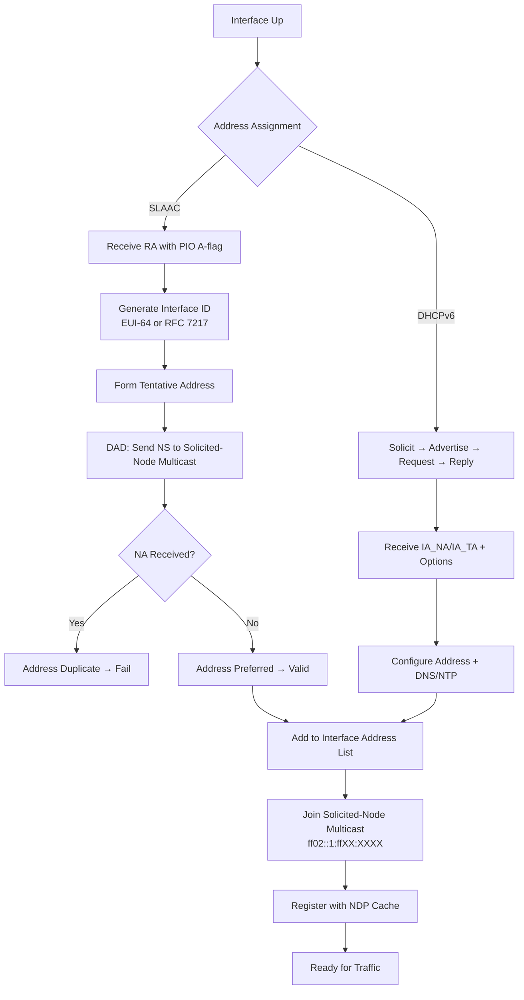

# IPv6 Addressing

## What it is
IPv6 is a 128-bit network layer addressing scheme defined in RFC 8200, providing 2^128 unique addresses. It replaces IPv4's 32-bit space to eliminate address exhaustion and simplifies header processing through fixed-length fields and extension headers.

## Why it matters
Every networked application, container orchestration platform, and cloud VPC now operates on dual-stack or IPv6-only infrastructure; understanding address structure, scope, and assignment mechanisms is required for correct service binding, firewall rules, and troubleshooting connectivity failures.

## How it actually works

### 128-bit format and textual representation
An IPv6 address is 16 octets (128 bits), typically written as eight groups of four hexadecimal digits separated by colons: `2001:0db8:85a3:0000:0000:8a2e:0370:7334`. Leading zeros within each 16-bit hextet may be omitted (`2001:db8:85a3:0:0:8a2e:370:7334`). The longest single contiguous sequence of all-zero hextets may be compressed once using `::` (`2001:db8:85a3::8a2e:370:7334`). If multiple equal-length zero sequences exist, the leftmost is compressed. The loopback address is `::1` (127 zero bits + 1). The unspecified address is `::` (all 128 bits zero).

### Address architecture (RFC 4291)
The high-order bits define the **Format Prefix (FP)** determining address type and scope:

| Prefix (binary) | Prefix (hex) | Type | Scope |
|-----------------|--------------|------|-------|
| `0000 0000` | `0000::/8` | Reserved (includes `::/128`, `::1/128`, `::ffff:0:0/96`) | — |
| `0000 0001` | `0100::/8` | Reserved | — |
| `0000 001` | `0200::/7` | Reserved | — |
| `0000 010` | `0400::/7` | Reserved | — |
| `0000 011` | `0600::/7` | Reserved | — |
| `0000 1` | `0800::/6` | Reserved | — |
| `0001` | `1000::/4` | Reserved | — |
| `001` | `2000::/3` | **Global Unicast** | Global |
| `010` | `4000::/3` | Reserved | — |
| `011` | `6000::/3` | Reserved | — |
| `100` | `8000::/3` | Reserved | — |
| `101` | `a000::/3` | Reserved | — |
| `110` | `c000::/3` | Reserved | — |
| `1110` | `e000::/4` | Reserved | — |
| `1111 0` | `f000::/5` | Reserved | — |
| `1111 10` | `f800::/6` | Reserved | — |
| `1111 110` | `fc00::/7` | **Unique Local Unicast (ULA)** | Site-local (RFC 4193) |
| `1111 1110 0` | `fe80::/10` | **Link-Local Unicast** | Link-local |
| `1111 1110 10` | `fec0::/10` | Deprecated (Site-Local) | — |
| `1111 1111` | `ff00::/8` | **Multicast** | Variable (see below) |

### Global Unicast Address (GUA) structure (RFC 4291, RFC 8200)
```
| n bits (global routing prefix) | m bits (subnet ID) | 128-n-m bits (interface ID) |
```
- **Global routing prefix**: Assigned by IANA → RIR → ISP/organization. Typically `/48` for sites, `/56` for small sites, `/64` for single subnet.
- **Subnet ID**: 16 bits when prefix is `/48`, allowing 65,536 subnets per site.
- **Interface ID**: 64 bits (modified EUI-64 or stable privacy address per RFC 7217). The universal/local bit (bit 6 of first octet, 0-indexed) is inverted from MAC OUI: `0` = globally unique (OUI), `1` = locally administered.

### Link-Local Unicast (`fe80::/10`)
- Prefix: `fe80::/64` (first 10 bits `1111 1110 10`, remaining 54 bits zero).
- Interface ID: 64 bits, same construction as GUA.
- **Never routed** beyond the originating link. Used for NDP, router discovery, DHCPv6.
- Every IPv6-enabled interface **must** have a link-local address.

### Unique Local Address (ULA) (`fc00::/7`)
- `fc00::/8`: Reserved for future centrally assigned ULAs (not used).
- `fd00::/8`: Locally assigned ULAs. Format: `fd` + 40-bit random Global ID (RFC 4193 §3.2) + 16-bit Subnet ID + 64-bit Interface ID.
- Not globally routable; routable within a site or between sites via VPN.

### Multicast (`ff00::/8`)
Format: `ff` + **flags** (4 bits) + **scope** (4 bits) + **group ID** (112 bits).
- Flags: `|0|R|P|T|` — `R`=Rendezvous (RFC 3956), `P`=Prefix-based (RFC 3306), `T`=Transient (1) vs Permanent (0).
- Scope values: `1`=Interface-local, `2`=Link-local, `3`=Realm-local, `4`=Admin-local, `5`=Site-local, `8`=Organization-local, `e`=Global.
- Well-known groups: `ff02::1` (all nodes link-local), `ff02::2` (all routers link-local), `ff02::1:ffxx:xxxx` (Solicited-Node for NDP).

### Anycast
Syntactically identical to unicast; assigned from unicast space (typically subnet-router anycast: subnet prefix + 128 zero bits). Delivered to nearest interface per routing metric.

### IPv4-mapped and IPv4-compatible addresses
- `::ffff:0:0/96` (IPv4-mapped): Embeds IPv4 address in low 32 bits. Used by dual-stack sockets (RFC 4291 §2.5.5.2). `::ffff:192.0.2.1` → `::ffff:c000:0201`.
- `::/96` (IPv4-compatible): **Deprecated** (RFC 4291). Was used for automatic tunneling.

### Address assignment mechanisms
1. **SLAAC (Stateless Address Autoconfiguration)** — RFC 4862, RFC 8200. Router Advertisement (RA) carries Prefix Information Option (PIO) with `A` (Autonomous) flag set. Host generates Interface ID (EUI-64 or RFC 7217), combines with prefix, runs DAD (Duplicate Address Detection) via NS/NA.
2. **DHCPv6 (Stateful)** — RFC 8415. Client solicits (`ff02::1:2`), server advertises, client requests, server replies with IA_NA (Non-temporary Address) or IA_TA (Temporary Address). Can provide DNS, NTP, other options via Option Request Option (ORO).
3. **DHCPv6-PD (Prefix Delegation)** — RFC 3633. Delegates `/48`, `/56`, `/60` prefixes to downstream routers.
4. **Manual/Static** — Configured via OS netlink, `ip addr add`, or cloud metadata.

### Neighbor Discovery Protocol (NDP) — RFC 4861
Replaces ARP, ICMPv4 Redirect, Router Discovery. Uses ICMPv6 (protocol 58):
- **Router Solicitation (RS, type 133)** → **Router Advertisement (RA, type 134)**: Prefix, MTU, hop limit, flags (`M`=Managed/stateful DHCPv6, `O`=Other config via DHCPv6), lifetime.
- **Neighbor Solicitation (NS, type 135)** → **Neighbor Advertisement (NA, type 136)**: Address resolution, DAD, NUD (Neighbor Unreachability Detection).
- **Redirect (type 137)**: Better next-hop.

### Extension headers (RFC 8200)
Fixed 40-byte base header → zero or more extension headers (Hop-by-Hop Options, Routing, Fragment, Destination Options, Authentication, Encapsulating Security Payload) → Upper-layer protocol (TCP/UDP/ICMPv6). `Next Header` field chains them. Fragmentation only at source; routers do not fragment (Path MTU Discovery required).

## Architecture / flow



## Key terms
**Solicited-Node Multicast** — `ff02::1:ff00:0000/104` mapped from low 24 bits of unicast address; used for NDP address resolution and DAD, limiting multicast disruption.
**DAD (Duplicate Address Detection)** — NS sent with unspecified source (`::`) to tentative address's solicited-node multicast; any NA reply indicates collision.
**NUD (Neighbor Unreachability Detection)** — Confirms reachability of cached neighbors via unicast NS/NA; states: INCOMPLETE, REACHABLE, STALE, DELAY, PROBE.
**Interface ID** — Low 64 bits of unicast address; modified EUI-64 (MAC with FFFE inserted, U/L bit flipped) or semantically opaque per RFC 7217.
**Prefix Information Option (PIO)** — RA option (type 3) carrying prefix, prefix length, valid/preferred lifetimes, `A` (autonomous), `L` (on-link) flags.
**Scope Zone Index** — `%interface` suffix (e.g., `fe80::1%eth0`) disambiguating link-local/ULA addresses across multiple interfaces; required for socket bind/sendto.

## Example
```bash
# Assign static GUA and verify DAD completion
ip -6 addr add 2001:db8:1::42/64 dev eth0
ip -6 addr show dev eth0 tentative
# Output shows "tentative" flag until DAD passes (typically ~1s), then "valid preferred"
```

## Common mistakes
- **Binding to `::` without scope zone for link-local**: `bind(sock, (sockaddr*)&in6{sin6_addr=in6addr_linklocal}, ...)` fails or binds to wrong interface; must set `sin6_scope_id` via `if_nametoindex("eth0")`.
- **Assuming `/64` prefix on all links**: Point-to-point links may use `/127` (RFC 6164) to reduce ND cache exhaustion; `/64` required for SLAAC.
- **Filtering ICMPv6 "Packet Too Big" (type 2)**: Breaks Path MTU Discovery, causing black holes for packets >1280 bytes with DF bit set.
- **Using `::ffff:0:0/96` for ACL matching**: IPv4-mapped addresses only appear in socket API; on-wire packets never carry them. Match real IPv4-in-IPv6 encapsulation (protocol 41) or dual-stack sockets separately.

## Lesser-known internals
- **Temporary addresses (RFC 4941 / RFC 8981)**: Privacy extensions generate rotating Interface IDs (default lifetime 24h preferred, 7d valid) alongside stable RFC 7217 address; `ip -6 addr` shows `temp`/`sec` flags. Outbound connections prefer temporary; inbound services use stable.
- **Solicited-Node multicast join is per-address**: Each unicast/anycast address on an interface joins its own `ff02::1:ffXX:XXXX` group; 100 addresses = 100 multicast listeners on the NIC.
- **Fragment header `Identification` field is 32 bits** (vs IPv4's 16 bits), chosen by source via hash of {src, dst, flow label} to reduce collision probability in high-throughput flows.

## Topics to explore further
- **IPv6 Segment Routing (SRv6)** — Encodes path as ordered list of SIDs in Routing Extension Header; replaces MPLS for traffic engineering.
- **DHCPv6 Options for Container Orchestration** — Option 112 (CAPWAP), Option 119 (Domain Search), and vendor-specific options for Kubernetes pod addressing.
- **IPv6-only Transition Mechanisms** — NAT64/DNS64 (RFC 6146/6147), 464XLAT (RFC 6877), MAP-E (RFC 7597), DS-Lite (RFC 6333) — each with distinct MTU, fragmentation, and port-mapping behaviors.

## Learn next
- **NDP (Neighbor Discovery Protocol)** — Directly implements address resolution, router discovery, and reachability detection that IPv6 addressing depends on.
- **IPv6 Routing Header & SRv6** — Extension header mechanics that enable programmable forwarding paths using the address space itself.
- **IPv6 Firewalling (nftables/ip6tables)** — Header chain order, extension header matching, and connection tracking nuances distinct from IPv4.