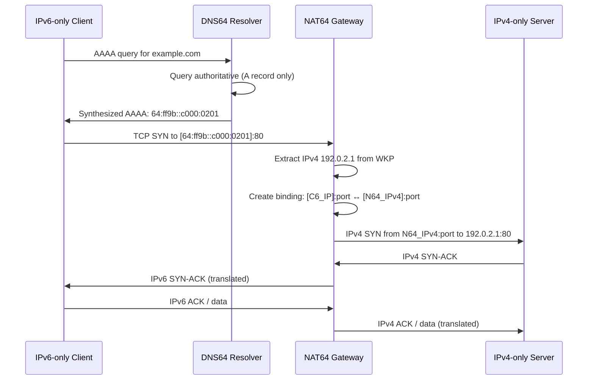

# IPv6 — Transition Mechanisms

## What it is
IPv6 transition mechanisms are standardized protocols and architectures that enable communication between IPv6-only and IPv4-only hosts, and facilitate incremental deployment of IPv6 across networks that still rely on IPv4 infrastructure. They operate at Layer 3 (network layer) and Layer 4 (transport layer) to provide interoperability without requiring a flag-day migration.

## Why it matters
Despite IPv6 standardization in 1998, IPv4 still carries significant production traffic; developers building networked services, operating cloud infrastructure, or debugging connectivity issues must understand how packets traverse mixed-version paths, where address translation occurs, and why certain failure modes (MTU black holes, asymmetric routing, DNS synthesis) appear only in transition scenarios.

## How it actually works

### Dual Stack (RFC 4213)
Dual stack runs IPv4 and IPv6 protocol stacks simultaneously on the same interface. The kernel maintains separate routing tables, neighbor caches (ARP for IPv4, NDP for IPv6), and socket layers. Applications select the address family at socket creation (`AF_INET` vs `AF_INET6`). DNS resolution via `getaddrinfo()` returns both A and AAAA records; RFC 8305 (Happy Eyeballs v2) specifies the connection attempt algorithm: initiate IPv6 and IPv4 connections in parallel (or with 50ms stagger), use the first successful connection, cache the preferred family for subsequent connections. No packet translation occurs — each flow remains purely IPv4 or purely IPv6 end-to-end.

### Configured Tunneling (RFC 4213, RFC 2473)
Encapsulates IPv6 packets inside IPv4 (protocol 41) or IPv6 inside IPv6. Tunnel endpoints are explicitly configured with source/destination IPv4 addresses. The encapsulating node decrements the inner IPv6 Hop Limit, copies ECN bits per RFC 6040, sets outer IPv4 TTL (typically 64), and fragments if the inner packet exceeds the path MTU minus 20 bytes (IPv4 header). The decapsulator verifies the outer source matches the configured peer, validates the inner IPv6 header, and forwards to the IPv6 stack. MTU: default 1280 bytes (IPv6 minimum) minus encapsulation overhead; operators must adjust `ip tunnel` MTU or enable PMTUD.

### 6to4 (RFC 3056, deprecated by RFC 7526)
Automatic tunneling using the **2002::/16** prefix. A 6to4 router embeds its public IPv4 address in bits 16–47 of the IPv6 prefix: `2002:V4ADDR::/48` (e.g., IPv4 192.0.2.1 → `2002:c000:0201::/48`). Relay routers (anycast `192.88.99.1` / `2002:c058:6301::`) interconnect 6to4 sites with native IPv6. Packet flow: IPv6 host → 6to4 router (encapsulate in IPv4 proto 41 to relay) → native IPv6. Reverse path: native IPv6 → relay (encapsulate to 6to4 router's IPv4) → IPv6 host. **Critical flaw**: relay selection is anycast-based with no return-path symmetry guarantee, causing asymmetric routing and black holes. 6to4 does not work behind NAT unless the NAT forwards proto 41 (rare). Deprecated due to operational unreliability.

### NAT64 (RFC 6146, RFC 6144, RFC 6052)
Stateful translation of IPv6-only client ↔ IPv4-only server. The NAT64 gateway holds a **Well-Known Prefix (WKP) 64:ff9b::/96** (RFC 6052) or an NSP (Network-Specific Prefix) assigned from the operator's IPv6 space. IPv6 client sends to `64:ff9b::IPv4_ADDRESS` (e.g., `64:ff9b::c000:0201` for 192.0.2.1). NAT64 extracts the embedded IPv4 address, creates a binding (IPv6 src/dst/port ↔ IPv4 src/dst/port), translates headers: IPv6 → IPv4 (version, header length, TTL=HL, protocol, checksum recalculated), IPv4 → IPv6 (prepends WKP, sets HL=TTL-1, next header=protocol). **Port mapping**: 1:1 for TCP/UDP; ICMPv6 Echo Request (type 128) ↔ ICMPv4 Echo Request (type 8) with identifier/sequence preserved. **DNS64** (RFC 6147) synthesizes AAAA records from A records by embedding the IPv4 address in the WKP; the resolver must be DNSSEC-aware to avoid validation failures (CD bit handling per RFC 6147 §5.2).

### 464XLAT (RFC 6877)
Extends NAT64 for IPv4-literal applications (hardcoded IPv4 addresses, non-DNS discovery). Client-side **CLAT** (Customer-side Translator) implements a local NAT46 (IPv4 → IPv6) using a private IPv4 pool (typically 192.0.0.0/29 per RFC 7335) and the same WKP. Application binds to 127.0.0.1 or a virtual interface; CLAT translates to `64:ff9b::/96` destination, NAT64 translates to IPv4. Used in Android, iOS, Windows 10+ cellular stacks.

### DS-Lite (RFC 6333)
Dual-Stack Lite: IPv4-in-IPv6 tunneling from CPE (B4 element) to AFTR (Address Family Transition Router) at ISP. CPE has only IPv6 WAN; IPv4 LAN traffic encapsulated in IPv6 (protocol 4-in-6, IP protocol 41) to AFTR, which performs NAT44 (CGN) to public IPv4. Avoids IPv4 address consumption at CPE. MAP-E (RFC 7597) and MAP-T (RFC 7599) are stateless variants using port-set mapping algorithms (PSID) to share a single public IPv4 across multiple CPEs without per-flow state at AFTR.

### Protocol Numbers and Ports
- IPv6 encapsulation in IPv4: **IP protocol 41**
- IPv4 encapsulation in IPv6: **IP protocol 4** (4in6)
- NAT64: no dedicated port; operates on TCP/UDP/ICMP payloads
- DNS64: standard DNS port **53** (UDP/TCP)
- 6to4 relay anycast: **192.88.99.1** (IPv4), **2002:c058:6301::** (IPv6)

### MTU Considerations
| Mechanism | Overhead | Typical Effective MTU |
|-----------|----------|----------------------|
| 6in4 (proto 41) | 20 bytes (IPv4 header) | 1480 on Ethernet (1500 - 20) |
| 6to4 | 20 bytes | 1480 |
| NAT64 | 0 (translation, not encapsulation) | 1500 (but IPv6 min 1280 applies) |
| DS-Lite / MAP-E | 40 bytes (IPv6 header) | 1460 |
| 464XLAT | 0 (CLAT) + 0 (NAT64) | 1500 |

PMTUD must work end-to-end; ICMPv6 Packet Too Big (type 2) must not be filtered.

## Architecture / flow



## Key terms
**Well-Known Prefix (WKP)** — `64:ff9b::/96` reserved for NAT64 address embedding (RFC 6052).
**DNS64** — DNS resolver function that synthesizes AAAA records from A records using a NAT64 prefix (RFC 6147).
**CLAT** — Customer-side Translator (NAT46) enabling IPv4-literal apps on IPv6-only networks (RFC 6877).
**AFTR** — Address Family Transition Router; DS-Lite tunnel concentrator performing CGN (RFC 6333).
**PSID** — Port Set Identifier; algorithmic port-range allocation in MAP-E/MAP-T for stateless sharing (RFC 7597).
**Happy Eyeballs v2** — Connection race algorithm (RFC 8305) reducing dual-stack fallback latency to ~50ms.

## Example
```bash
# Linux: configure a 6in4 tunnel (sit) to a remote endpoint
ip tunnel add tun6in4 mode sit remote 203.0.113.10 local 198.51.100.5 ttl 64
ip link set dev tun6in4 up mtu 1480
ip -6 addr add 2001:db8:1::1/64 dev tun6in4
ip -6 route add ::/0 dev tun6in4
# Demonstrates manual configured tunneling (RFC 4213) with explicit MTU for IPv6-in-IPv4
```

## Common mistakes
- **Assuming 6to4 works behind NAT**: 6to4 requires the router to have a public IPv4 address and the NAT to forward IP protocol 41; most consumer NATs drop proto 41.
- **Filtering ICMPv6 Packet Too Big (type 2)**: Breaks PMTUD for all IPv6 transition mechanisms, causing silent black holes for packets >1280 bytes.
- **Using WKP `64:ff9b::/96` without DNS64**: IPv6 clients cannot discover the synthesized address; AAAA queries return NXDOMAIN or no record.
- **Expecting NAT64 to preserve IPv4 options or extension headers**: NAT64 translates only base headers; IPv4 options and IPv6 extension headers (except Hop-by-Hop, Destination Options) are dropped per RFC 6144 §4.1.

## Lesser-known internals
- **NAT64 binding timeout asymmetry**: TCP bindings typically expire after 2 hours (RFC 6146 §4.1), but UDP bindings expire in 30–120 seconds; long-lived UDP flows (VoIP, gaming) require application-level keepalives or PORT-RESTRICTED CONE behavior.
- **DNS64 synthesis with DNSSEC**: If the authoritative zone is signed and the resolver validates, DNS64 must either set the CD (Checking Disabled) bit on the upstream query or perform inline signing of the synthesized record; otherwise validation fails (RFC 6147 §5.2).
- **MAP-E/MAP-T port mapping collision**: The PSID algorithm (RFC 7597 §5.1) divides 16-bit port space into `2^(16 - PSID_len)` sets; if `PSID_len=6`, each CPE gets 1024 ports. Misconfigured `PSID_len` or `offset` causes port overlap and traffic misdelivery.

## Topics to explore further
- **464XLAT CLAT implementation details**: How Android's `clatd` and Windows `464xlat` manage the virtual IPv4 interface and routing policy rules.
- **YANG models for MAP-E/MAP-T** (RFC 8515, RFC 8516): NETCONF/RESTCONF configuration of border routers.
- **IPv6-only data center architectures**: RFC 8273 (IPv6-only in enterprise), SLAAC vs DHCPv6-PD for prefix delegation in transition contexts.
- **P4-programmable NAT64**: Offloading translation to programmable ASICs (TNA, Tofino) for line-rate performance.

## Learn next
- **DNS64 and DNSSEC interaction** — NAT64 deployments fail silently without proper DNSSEC handling; understanding CD-bit semantics and inline signing is essential for production.
- **Segment Routing over IPv6 (SRv6) for transition** — SRv6 SID behaviors (End.DT4, End.DT6) replace tunneling/translation with programmable segment lists.
- **IPv6-only Kubernetes networking** — CNI plugins (Cilium, Calico) implementing 464XLAT, NAT64, and eBPF-based translation for pod-to-legacy connectivity.