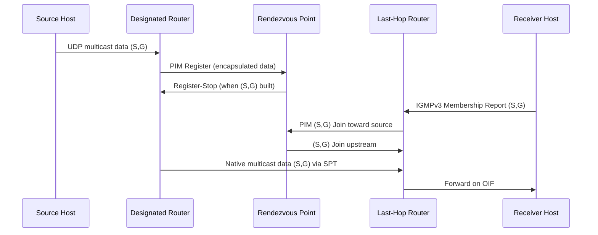

# Multicast & Broadcast

## What it is
**Broadcast** delivers a single packet to all hosts on a Layer 2 or Layer 3 segment using a destination address with all host bits set (IPv4: `255.255.255.255` limited broadcast, or subnet-directed broadcast `x.x.x.255`; IPv6 has no broadcast — uses `ff02::1` all-nodes multicast). **Multicast** delivers packets to a dynamically defined group of receivers using Class D IPv4 addresses (`224.0.0.0/4`) or IPv6 multicast addresses (`ff00::/8`), with routers replicating packets only on interfaces leading to interested receivers via IGMP/MLD snooping and multicast routing protocols.

## Why it matters
Broadcast storms can collapse switched networks; multicast enables efficient one-to-many distribution (video, financial feeds, service discovery) without per-receiver unicast replication, but requires explicit router/switch support and careful TTL/scope management to avoid flooding.

## How it actually works

### Address structure & scope
| Address Range | Scope | Use |
|---------------|-------|-----|
| `224.0.0.0/24` | Link-local (TTL=1) | Routing protocols (OSPF `224.0.0.5`, RIPv2 `224.0.0.9`), VRRP `224.0.0.18` |
| `224.0.1.0/24` | Global (internet) | NTP `224.0.1.1`, AUTO-RP `224.0.1.39/40` |
| `232.0.0.0/8` | SSM (Source-Specific Multicast) | RFC 4607 — no (*,G) state, only (S,G) |
| `239.0.0.0/8` | Administratively scoped | RFC 2365 — private multicast domains |
| `ff02::1` | Link-local all-nodes | IPv6 replacement for broadcast |
| `ff02::2` | Link-local all-routers | IPv6 router discovery |
| `ff05::1:3` | Site-local all-DHCP servers | DHCPv6 relay |

**IPv4-to-MAC mapping**: Low-order 23 bits of multicast IP → `01:00:5e:xx:xx:xx` (RFC 1112). Collisions possible: 32 IP groups map to same MAC. **IPv6-to-MAC**: Low-order 32 bits → `33:33:xx:xx:xx:xx` (RFC 2464).

### IGMP (Internet Group Management Protocol) — RFC 3376 (v3), RFC 2236 (v2), RFC 1112 (v1)
Hosts report group membership to local router. Router maintains per-interface **(*,G)** state (any-source) or **(S,G)** state (source-specific).

| Version | Query Type | Max Response Time | Key Mechanism |
|---------|------------|-------------------|---------------|
| v1 | General Query (dst `224.0.0.1`) | Fixed 10s | No leave message; timeout 2× query interval |
| v2 | General + Group-Specific Query | Configurable (default 10s) | **Leave Group** (`224.0.0.2`) triggers Group-Specific Query |
| v3 | General + Group-Specific + Group-and-Source-Specific | Configurable | **Source filtering**: INCLUDE/EXCLUDE mode per source list |

**IGMPv3 Membership Report** (type `0x22`, dst `224.0.0.22`):
```
0                   1                   2                   3
0 1 2 3 4 5 6 7 8 9 0 1 2 3 4 5 6 7 8 9 0 1 2 3 4 5 6 7 8 9 0 1
+-+-+-+-+-+-+-+-+-+-+-+-+-+-+-+-+-+-+-+-+-+-+-+-+-+-+-+-+-+-+-+-+
|  Type = 0x22  | Reserved      |           Checksum            |
+-+-+-+-+-+-+-+-+-+-+-+-+-+-+-+-+-+-+-+-+-+-+-+-+-+-+-+-+-+-+-+-+
| Reserved      |  Number of Group Records (M)                  |
+-+-+-+-+-+-+-+-+-+-+-+-+-+-+-+-+-+-+-+-+-+-+-+-+-+-+-+-+-+-+-+-+
|                       Group Record 1                          |
|                              ...                              |
|                       Group Record M                          |
+-+-+-+-+-+-+-+-+-+-+-+-+-+-+-+-+-+-+-+-+-+-+-+-+-+-+-+-+-+-+-+-+
```
**Group Record Type**: `MODE_IS_INCLUDE (1)`, `MODE_IS_EXCLUDE (2)`, `CHANGE_TO_INCLUDE (3)`, `CHANGE_TO_EXCLUDE (4)`, `ALLOW_NEW_SOURCES (5)`, `BLOCK_OLD_SOURCES (6)`.

**Querier election**: Lowest IP on subnet wins. Query Interval default 125s, Robustness Variable default 2 → Group Membership Interval = 260s.

**MLDv2** (RFC 3810) — IPv6 equivalent, uses ICMPv6 type 143 (Listener Report), 130/131/132 (Queries), dst `ff02::16`.

### IGMP/MLD Snooping (Layer 2)
Switches intercept IGMP/MLD messages to build **multicast forwarding database (MFDB)** mapping (VLAN, Group) → egress ports. Without snooping, multicast floods all ports in VLAN. **Querier function**: If no router, switch can act as IGMP querier (configurable). **Fast Leave**: Immediately prune port on Leave without Group-Specific Query — safe only for single-receiver ports.

### Multicast Routing Protocols

#### PIM-SM (Protocol Independent Multicast - Sparse Mode) — RFC 7761
**Core concept**: Shared tree (*,G) rooted at **Rendezvous Point (RP)** → source registers → switch to shortest-path tree (S,G).

1. **Bootstrap Router (BSR)** election (priority + hash mask length) distributes RP-set via `224.0.0.13` (PIMv2).
2. **Auto-RP** (Cisco proprietary): RP announce `224.0.1.39`, mapping agent `224.0.1.40`.
3. **Join/Prune** (dst `224.0.0.13`, proto 103): Upstream (*,G) or (S,G) state. Holdtime default 210s.
4. **Register** (unicast to RP): Encapsulates data packets from DR (Designated Router) near source. **Register-Stop** sent when (S,G) state built.
5. **Assert** on multi-access LAN: Highest metric/preference wins forwarder; loser prunes.
6. **S,G switchover**: Last-hop router sends (S,G) Join toward source when data rate > threshold (default 1 kbps).

**State machine complexity**: O(G × S) per router. **PIM-DM** (RFC 3973) — dense mode, flood-and-prune, no RP.

#### BIDIR-PIM (Bidirectional PIM) — RFC 5015
Single shared tree (*,G) for both directions. No (S,G) state. **Designated Forwarder (DF)** election per link via PIM DF Offer messages. Lower state but no optimal source path.

#### MSDP (Multicast Source Discovery Protocol) — RFC 3618
Inter-domain RP peering (TCP 639). **SA (Source Active)** messages advertise (S,G) across domains. **SA caching** reduces join latency. **Mesh groups** reduce SA flooding.

#### MVPN (Multicast VPN) — RFC 6513/6514
Multicast in MPLS/BGP VPNs. **Default MDT** (PIM in VRF) for control plane, **Data MDT** for high-bandwidth streams. **BGP-AD** (RFC 6514) auto-discovers PEs.

### TTL & Scope Control
- **IPv4 TTL**: Decremented at each hop. Link-local groups (`224.0.0.0/24`) sent with TTL=1. Admin-scoped (`239.0.0.0/8`) bounded by TTL thresholds or PIM border routers.
- **IPv6 Hop Limit**: Same semantics. Scope field in address: `1`=interface-local, `2`=link-local, `4`=admin-local, `5`=site-local (deprecated), `8`=organization, `e`=global.

### Socket API (Linux `man 7 ip`, `man 7 ipv6`)
```c
// Join IPv4 multicast group
struct ip_mreqn mreq = {
    .imr_multiaddr.s_addr = inet_addr("239.1.2.3"),
    .imr_address.s_addr = htonl(INADDR_ANY),
    .imr_ifindex = if_nametoindex("eth0")
};
setsockopt(sock, IPPROTO_IP, IP_ADD_MEMBERSHIP, &mreq, sizeof(mreq));

// Source-specific join (IGMPv3)
struct ip_mreq_source mreqs = {
    .imr_multiaddr.s_addr = inet_addr("232.1.2.3"),
    .imr_sourceaddr.s_addr = inet_addr("192.0.2.1"),
    .imr_interface.s_addr = htonl(INADDR_ANY)
};
setsockopt(sock, IPPROTO_IP, IP_ADD_SOURCE_MEMBERSHIP, &mreqs, sizeof(mreqs));

// Set outgoing interface / TTL
setsockopt(sock, IPPROTO_IP, IP_MULTICAST_IF, &iface_addr, sizeof(iface_addr));
setsockopt(sock, IPPROTO_IP, IP_MULTICAST_TTL, &ttl, sizeof(ttl));  // default 1

// Loopback control (receive own packets)
int loop = 1;
setsockopt(sock, IPPROTO_IP, IP_MULTICAST_LOOP, &loop, sizeof(loop));
```

**IPv6 equivalents**: `IPV6_ADD_MEMBERSHIP` (`struct ipv6_mreq`), `IPV6_MULTICAST_HOPS`, `IPV6_MULTICAST_IF`, `IPV6_MULTICAST_LOOP`.

### PIM Packet Format (RFC 7761)
```
0                   1                   2                   3
0 1 2 3 4 5 6 7 8 9 0 1 2 3 4 5 6 7 8 9 0 1 2 3 4 5 6 7 8 9 0 1
+-+-+-+-+-+-+-+-+-+-+-+-+-+-+-+-+-+-+-+-+-+-+-+-+-+-+-+-+-+-+-+-+
| Version=2 | Type  | Reserved  |          Checksum             |
+-+-+-+-+-+-+-+-+-+-+-+-+-+-+-+-+-+-+-+-+-+-+-+-+-+-+-+-+-+-+-+-+
|                      Type-specific fields                     |
+-+-+-+-+-+-+-+-+-+-+-+-+-+-+-+-+-+-+-+-+-+-+-+-+-+-+-+-+-+-+-+-+
```
**Types**: `0` Hello, `1` Join/Prune, `2` Register, `3` Register-Stop, `4` Assert, `5` Bootstrap, `6` Candidate-RP-Advertisement, `7` State-Refresh (PIM-DM).

## Architecture / flow



## Key terms
**Rendezvous Point (RP)** — Root of shared tree (*,G) in PIM-SM; receives source registers and receiver joins.
**Designated Router (DR)** — Router on multi-access LAN responsible for sending PIM Registers (source side) or IGMP Queries (receiver side).
**OIF (Outgoing Interface List)** — Interfaces on which a router forwards multicast packets for a given (S,G) or (*,G) entry.
**Reverse Path Forwarding (RPF)** — Check that packet arrives on interface toward source (unicast routing table); fails → drop.
**SSM (Source-Specific Multicast)** — Model using `232.0.0.0/8` (IPv4) / `ff3x::/32` (IPv6) where receivers specify source; no RP, no (*,G) state.
**Scope** — Administrative or TTL boundary limiting multicast propagation; IPv6 encodes scope in address bits 8-11.

## Example
```bash
# Linux: Join multicast group 239.1.2.3 port 5000 on eth0, capture with tcpdump
ip maddr add 239.1.2.3 dev eth0
tcpdump -i eth0 -n udp port 5000 and dst host 239.1.2.3

# Cisco: Enable PIM-SM, static RP, IGMPv3 on VLAN 10
ip multicast-routing
ip pim rp-address 10.1.1.1
interface vlan 10
 ip pim sparse-mode
 ip igmp version 3
```

## Common mistakes
- **Assuming TTL=1 works beyond local link** — Link-local groups (`224.0.0.0/24`) are non-routable; use global/admin-scoped groups for cross-subnet.
- **Forgetting `IP_MULTICAST_IF` on multi-homed hosts** — Kernel picks default route interface; outbound multicast may egress wrong NIC.
- **Enabling PIM-SM without RP configuration** — No RP = no (*,G) tree = receivers never get traffic; use `ip pim rp-address` or BSR/Auto-RP.
- **Using broadcast `255.255.255.255` for service discovery in containerized environments** — Docker/container networks often disable broadcast; use multicast `ff02::1` (IPv6) or `224.0.0.251` (mDNS) instead.

## Lesser-known internals
- **IGMPv3 EXCLUDE mode with empty source list** ≠ "all sources" — it means "no sources"; use INCLUDE with desired sources or MODE_IS_EXCLUDE with specific blocked sources.
- **PIM Assert metric/preference tiebreaker** — On LAN with multiple forwarders, highest metric (AD) wins; if equal, highest IP wins. Loser sends Prune, but **Assert Cancel** not standardized — loser may re-assert after holdtime expiry.
- **Kernel IGMP/MLD report suppression** — Hosts delay reports by random `[0, Max Response Time]`; if another host reports same group first, report suppressed. Defeated by `IP_MULTICAST_ALL` (Linux 4.5+) or per-socket `IP_MULTICAST_LOOP=0` + manual join.

## Topics to explore further
- **BIER (Bit Index Explicit Replication)** — RFC 8279; multicast without per-flow state, uses bitstring in packet header.
- **PGM (Pragmatic General Multicast)** — RFC 3208; reliable multicast transport (NACK-based repair), used in financial markets.
- **Multicast VPN (MVPN) Profile 0-14** — Rosen Draft vs. BGP-AD vs. Partitioned MDT; data plane encapsulation (GRE, MPLS, VXLAN).
- **SR-P2MP (Segment Routing Point-to-Multipoint)** — RFC 9256; P2MP trees via SR replication segments, no PIM state.

## Learn next
- **PIM-SM deep dive** — RP placement, BSR vs. Auto-RP vs. static RP, SPT switchover thresholds, Anycast-RP (MSDP vs. PIM Anycast-RP RFC 4610) — *directly builds on multicast routing internals*
- **IPv6 multicast (MLDv2, PIM-SMv6, embedded-RP)** — Address format `ff7e:...`, embedded RP in group address, no BSR in some deployments — *same protocols, different addressing/operations*
- **Multicast QoS & congestion control** — IGMP/MLD snooping with querier election, multicast pacing, ECN for multicast, RED on replication queues — *operational reality for production video/financial feeds*