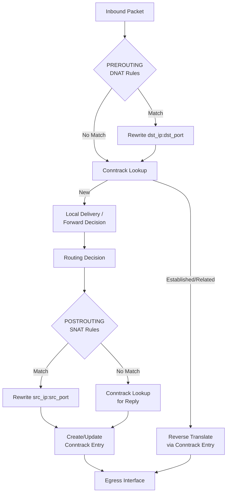

# NAT — Network Address Translation

## What it is
NAT modifies IP packet headers in transit to map one IP address space into another, typically translating private RFC 1918 addresses to a public IPv4 address. It operates at Layer 3 (network layer) by rewriting source or destination IP addresses and optionally Layer 4 (transport layer) port numbers, maintaining a stateful mapping table to reverse the translation for return traffic.

## Why it matters
IPv4 address exhaustion makes NAT unavoidable for most internet-connected networks; developers hit it when services fail to receive inbound connections, when outbound connections appear from unexpected IPs, or when protocols embed IP addresses in payloads (FTP, SIP, WebRTC) requiring ALGs or explicit traversal logic.

## How it actually works
NAT maintains a **translation table** keyed by the 5-tuple: `(protocol, src_ip, src_port, dst_ip, dst_port)`. Each entry maps an internal endpoint to an external endpoint with a timeout. The kernel processes packets through a defined hook chain (e.g., Netfilter `PREROUTING`, `POSTROUTING` in Linux).

**SNAT (Source NAT)** rewrites the source IP/port of outbound packets. The most common form is **masquerading**: the external IP is the interface's primary address, selected at `POSTROUTING`. For a TCP SYN from `10.0.0.5:54321` to `93.184.216.34:80`, the NAT device allocates an external port (e.g., `203.0.113.10:49152`), creates a table entry `TCP 10.0.0.5:54321 ↔ 203.0.113.10:49152 → 93.184.216.34:80`, rewrites the packet, and forwards it. Return packets match the table by `(dst_ip, dst_port)` = `(203.0.113.10, 49152)` and are reverse-translated.

**DNAT (Destination NAT)** rewrites the destination IP/port of inbound packets, typically at `PREROUTING`. A port forward `203.0.113.10:8080 → 10.0.0.5:80` creates a static table entry. Inbound SYN to `203.0.113.10:8080` matches the DNAT rule, destination becomes `10.0.0.5:80`, and a reverse SNAT entry is implicitly created for the reply path.

**PAT / NAPT (Network Address Port Translation)** — RFC 3022 term for SNAT with port translation, allowing many internal hosts to share one public IP. Port allocation uses a **per-protocol, per-external-IP bitmap** or hash table. Linux `nf_nat` uses a **randomized port selection** from the ephemeral range (`32768–60999` by default, `/proc/sys/net/ipv4/ip_local_port_range`) to reduce collision predictability. On collision, it retries up to `nf_nat_htable_size` buckets (default 8192 entries per zone).

**ICMP handling**: ICMP queries (Echo Request type 8) use the **Identifier field** (bytes 4–5) as the pseudo-port. NAT rewrites this identically to UDP/TCP ports. ICMP errors (Destination Unreachable, Time Exceeded) contain the original IP header + 8 bytes of payload; NAT must inspect the embedded header to find the matching conntrack entry and rewrite the inner addresses.

**ALGs (Application Layer Gateways)**: Protocols embedding addresses in payload (FTP PORT/EPRT, SIP SDP, H.323) require kernel modules (`nf_nat_ftp`, `nf_nat_sip`) that parse application data, update embedded IPs/ports, and adjust TCP sequence numbers via `skb` expansion. This is fragile — TLS breaks it, and modern designs avoid ALGs via ICE/STUN/TURN.

**Timeouts** (Linux `nf_conntrack` defaults, tunable via `/proc/sys/net/netfilter/nf_conntrack_*_timeout_*`):
- TCP SYN_SENT: 120s
- TCP SYN_RECV: 60s
- TCP ESTABLISHED: 432000s (5 days)
- TCP FIN_WAIT: 120s
- TCP TIME_WAIT: 120s
- UDP unreplied: 30s
- UDP replied: 180s
- ICMP: 30s

**RFCs**: RFC 1631 (historic), RFC 3022 (Traditional NAT), RFC 4787 (NAT Behavioral Requirements — defines **Endpoint-Independent Mapping**, **Address-Dependent Mapping**, **Address-and-Port-Dependent Mapping**), RFC 5382 (NAT Behavioral Requirements for TCP), RFC 6888 (Common NAT Traversal Requirements).

## Architecture / flow


## Key terms
**Conntrack** — Kernel subsystem tracking connection state (5-tuple + timeout + status bits) for NAT and stateful firewalling; distinct from NAT but required by it.
**Masquerade** — SNAT variant that dynamically uses the egress interface's primary IPv4 address; designed for dynamic DHCP uplinks.
**Hairpin NAT** — NAT loopback: internal host accesses internal server via public DNAT address; requires both DNAT (PREROUTING) and SNAT (POSTROUTING) to rewrite source to NAT device IP so reply returns via NAT.
**Endpoint-Independent Mapping** — RFC 4787 behavior: same internal (IP, port) maps to same external (IP, port) regardless of destination; enables hole punching.
**Port Preservation** — NAT attempts to keep internal source port equal to external port; fails on collision, then falls back to random allocation.
**NAT64/DNS64** — IPv6-to-IPv4 translation: DNS64 synthesizes AAAA records from A records (prefix `64:ff9b::/96`), NAT64 translates IPv6 packets to IPv4 and vice versa.

## Example
```bash
# nftables: SNAT masquerade + DNAT port forward (TCP 8080 -> 10.0.0.5:80)
table ip nat {
    chain prerouting {
        type nat hook prerouting priority -100; policy accept;
        iifname "eth0" tcp dport 8080 dnat to 10.0.0.5:80
    }
    chain postrouting {
        type nat hook postrouting priority 100; policy accept;
        oifname "eth0" masquerade
    }
}
# Demonstrates: DNAT at PREROUTING for inbound, masquerade at POSTROUTING for outbound
```

## Common mistakes
- **Assuming port preservation always works** — NAT devices silently remap on collision; never hardcode external port equality in application logic.
- **Forgetting conntrack table sizing** — Default `nf_conntrack_max` (often 65536) exhausts under high connection churn; tune `nf_conntrack_max` and `nf_conntrack_buckets` (hash size = max/4) for load balancers.
- **Using DNAT without hairpin SNAT** — Internal clients accessing the public DNAT IP fail because server replies directly to client (asymmetric routing); add `POSTROUTING` SNAT for internal subnet sourcing the DNAT VIP.
- **Expecting FTP/SIP to work through NAT without ALGs** — Passive FTP works; active FTP and SIP require `nf_conntrack_ftp`/`nf_conntrack_sip` modules loaded, which fail under TLS or non-standard ports.

## Lesser-known internals
- **Conntrack zones** (`ct zone`) isolate NAT tables per VRF/tenant; packets only match entries in the same zone. Default zone is 0. Critical for multi-tenant routers and Kubernetes CNI plugins (Calico, Cilium).
- **TCP sequence number adjustment** — When ALGs modify payload length (e.g., FTP PORT command rewrite), NAT must delta-adjust subsequent sequence/ack numbers in both directions. Kernel does this via `nf_nat_seq_offset` stored in conntrack entry; visible in `conntrack -L -o extended` as `nat-seq-correction`.
- **Deterministic NAT (RFC 7422 / CGNAT)** — Maps internal IP + port range to external IP + port range algorithmically (no state table). Used in carrier-grade NAT for logging efficiency; Linux `xt_NETMAP` target implements static 1:1 subnet mapping, not full deterministic PAT.

## Topics to explore further
- **ICE/STUN/TURN (RFC 8445/5389/5766)** — Standardized NAT traversal for real-time media; replaces ALGs.
- **PCP (Port Control Protocol, RFC 6887)** — Successor to UPnP IGD; allows hosts to request explicit port mappings from NAT gateway.
- **NAT64/DNS64 deployment (RFC 6146/6147)** — IPv6-only networks accessing IPv4 services; growing in mobile carrier networks.
- **eBPF-based NAT (Cilium, Katran)** — Userspace/kernel-bypass NAT using XDP/TC hooks; avoids conntrack lock contention at scale.

## Learn next
- **Connection Tracking (conntrack)** — NAT is built on conntrack; understanding its state machine, zones, and timeouts is essential for debugging.
- **IPv6 Transition Mechanisms (NAT64, 464XLAT, MAP-E)** — IPv4 exhaustion drives these; they replace or augment traditional NAT.
- **eBPF/XDP for Packet Processing** — Modern high-performance NAT implementations bypass netfilter entirely; relevant for cloud-native networking.