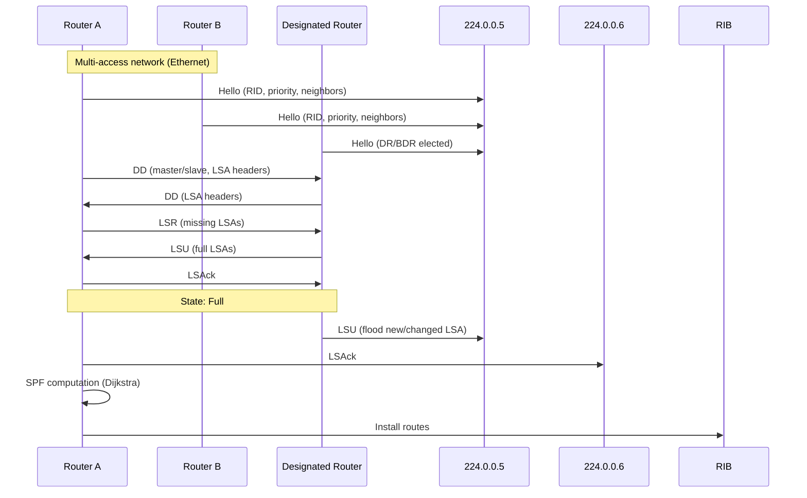

# OSPF — Open Shortest Path First

## What it is
OSPF is a link-state interior gateway protocol (IGP) that computes loop-free shortest-path trees using Dijkstra's algorithm over a synchronized link-state database (LSDB). It operates directly over IP (protocol 89), not TCP or UDP, and organizes networks into hierarchical areas to bound flooding scope and SPF computation. OSPFv2 (RFC 2328) supports IPv4; OSPFv3 (RFC 5340) supports IPv6 with protocol-independent LSAs.

## Why it matters
OSPF is the dominant IGP in enterprise and service-provider networks; understanding its LSDB synchronization, area hierarchy, and SPF behavior is essential for diagnosing route flapping, convergence delays, and suboptimal path selection in production environments.

## How it actually works

### Protocol basics
- **IP protocol number**: 89 (not a port — OSPF encapsulates directly in IP)
- **Multicast addresses**: 224.0.0.5 (AllSPFRouters), 224.0.0.6 (AllDRouters)
- **Hello interval**: 10 seconds (broadcast/point-to-point), 30 seconds (NBMA)
- **Dead interval**: 4 × Hello interval (default 40s / 120s)
- **Router ID**: 32-bit identifier, typically highest loopback IP or configured `router-id`
- **Authentication**: Null (type 0), Simple password (type 1), Cryptographic (type 2 — MD5/HMAC-SHA per RFC 5709)

### Neighbor state machine (RFC 2328 §10.1)
```
Down → Attempt → Init → 2-Way → ExStart → Exchange → Loading → Full
```
- **2-Way**: Bidirectional communication confirmed; DR/BDR election occurs on multi-access networks
- **ExStart**: Master/slave negotiation for DD sequence numbers (higher Router ID = master)
- **Exchange**: Database Description (DD) packets summarize LSDB (LSA headers only)
- **Loading**: Link State Request (LSR) / Link State Update (LSU) / Link State Acknowledgment (LSAck) for missing LSAs
- **Full**: LSDB synchronized; adjacency established

### LSA types (OSPFv2)
| Type | Name | Scope | Originator | Key fields |
|------|------|-------|------------|------------|
| 1 | Router LSA | Area | Every router | Links: point-to-point, transit, stub, virtual |
| 2 | Network LSA | Area | DR | Attached routers, network mask |
| 3 | Summary LSA (Network) | Area | ABR | Inter-area prefixes, metric |
| 4 | Summary LSA (ASBR) | Area | ABR | ASBR router ID, metric to ASBR |
| 5 | AS External LSA | AS | ASBR | External prefix, metric type (E1/E2), forwarding address, tag |
| 6 | Group Membership LSA | Area | — | Multicast extensions (RFC 1584, obsolete) |
| 7 | NSSA External LSA | NSSA area | ASBR | Converted to Type 5 by ABR |
| 8 | Link LSA | Link-local | OSPFv3 router | Link-local address, prefix list |
| 9 | Intra-Area Prefix LSA | Area | OSPFv3 router/DR | Stub/transit prefixes |
| 10 | Opaque LSA (link) | Link | — | Traffic engineering (RFC 3630) |
| 11 | Opaque LSA (area) | Area | — | Graceful restart (RFC 3623) |

**LSA header (20 bytes)**: LS Age (16), Options (8), LS Type (8), Link State ID (32), Advertising Router (32), LS Sequence Number (32), LS Checksum (16), Length (16). Sequence number wraps at 0x80000000 → 0x80000001 (initial); MaxAge = 3600s; MinLSInterval = 5s; MinLSArrival = 1s.

### Area hierarchy
- **Area 0 (backbone)**: All non-backbone areas must connect to Area 0 (physically or via virtual link)
- **ABR (Area Border Router)**: Member of multiple areas; originates Type 3/4 Summary LSAs; runs separate SPF per area
- **ASBR (Autonomous System Boundary Router)**: Redistributes external routes; originates Type 5/7 LSAs
- **Stub area**: No Type 5 LSAs; ABR injects default route (Type 3, metric 1)
- **Totally stubby area**: No Type 3/4/5; only default route from ABR (Cisco proprietary, widely implemented)
- **NSSA (Not-So-Stubby Area)**: Allows Type 7 (NSSA External) → ABR translates to Type 5 if P-bit set

### SPF computation (Dijkstra)
- **Algorithm**: Dijkstra with binary heap: O((E + V) log V); Fibonacci heap: O(E + V log V)
- **Vertex set**: Routers (Type 1) + Networks (Type 2) as pseudo-nodes
- **Edge weights**: Interface cost = `reference-bandwidth / interface-bandwidth` (default reference = 100 Mbps; `auto-cost reference-bandwidth` adjusts)
- **Execution**: Triggered by LSDB change; SPF hold timer (default 0ms) and SPF max-wait timer (default 5000ms) throttle recomputation (exponential backoff)
- **Output**: Shortest-path tree rooted at computing router → RIB installation

### DR/BDR election (multi-access networks)
- **Priority**: 0–255 (0 = ineligible); default 1
- **Tiebreaker**: Highest Router ID
- **Non-preemptive**: Existing DR/BDR retain role unless they fail; new higher-priority router becomes DR only on DR failure
- **AllDRouters (224.0.0.6)**: DR/BDR listen here; DROthers send LSUs to 224.0.0.6; DR floods to 224.0.0.5
- **Adjacencies**: DROthers form Full only with DR/BDR (2 adjacencies); DR/BDR form Full with all (n-1 adjacencies)

### Virtual links
- Connect discontinuous Area 0 or attach non-backbone area to Area 0 through transit area
- Configured between two ABRs; treated as point-to-point unnumbered link
- Requires transit area not to be stub/NSSA

### Route types and preference order
1. Intra-area (Type 1/2) — lowest AD (110)
2. Inter-area (Type 3/4) — AD 110
3. External Type 1 (E1) — metric = internal cost + external cost
4. External Type 2 (E2) — metric = external cost only (default for redistributed routes)
5. NSSA Type 7 → Type 5 translation — follows E1/E2 semantics

## Architecture / flow



## Key terms
**Link-State Advertisement (LSA)** — Flooded unit of topology information; each has unique (LS Type, Link State ID, Advertising Router) tuple and sequence number.
**Link-State Database (LSDB)** — Per-area collection of all LSAs; identical across all routers in an area at convergence.
**Area Border Router (ABR)** — Router with interfaces in multiple areas; originates Summary LSAs (Type 3/4) and runs independent SPF per area.
**Autonomous System Boundary Router (ASBR)** — Router that redistributes external routes into OSPF; originates Type 5 (or Type 7 in NSSA) LSAs.
**Designated Router (DR)** — Elected on multi-access networks to reduce adjacency count from O(n²) to O(n); floods LSAs on behalf of segment.
**Sequence Number** — 32-bit signed integer (0x80000001 to 0x7FFFFFFF) preventing stale LSA acceptance; wraps require MaxAge flush.

## Example
```bash
# Cisco IOS-XE OSPF configuration with area hierarchy
router ospf 1
 router-id 10.0.0.1
 auto-cost reference-bandwidth 100000
 passive-interface default
 no passive-interface GigabitEthernet0/0
 network 10.0.0.0 0.0.0.255 area 0
 network 10.1.0.0 0.0.255.255 area 1
 area 1 stub no-summary
 redistribute connected subnets route-map CONNECTED_TO_OSPF
!
route-map CONNECTED_TO_OSPF permit 10
 match interface Loopback0
 set metric-type type-1
```
Demonstrates: explicit router-id, reference-bandwidth for 100G interfaces, passive-interface default for security, stub totally-stubby area (no-summary), and E1 external metric type.

## Common mistakes
- **Assuming DR election is preemptive**: It is not; a higher-priority router added later will not become DR until current DR fails.
- **Setting identical router-id on multiple routers**: Causes LSDB corruption and SPF loops; router-id must be unique per OSPF domain.
- **Mismatched Hello/Dead intervals or MTU**: Prevents adjacency formation; MTU mismatch silently drops DD packets (no fragmentation).
- **Redistributing without route-map/filter**: Floods entire RIB as Type 5 LSAs, bloating LSDB and SPF time across all areas.
- **Using Type 2 (E2) metric for external paths requiring internal cost comparison**: E2 ignores internal cost to ASBR, causing suboptimal exit selection.

## Lesser-known internals
- **LSA pacing**: Cisco and others pace LSU transmission (default 33ms interval, 1 packet per interval) to avoid overwhelming neighbors; controlled by `timers pacing flood` / `timers pacing lsa-group`.
- **SPF incremental computation (iSPF)**: RFC 3137; recomputes only affected subtree when single LSA changes. Not universally implemented; Cisco supports `ispf` command but disabled by default.
- **LSA group pacing**: LSAs refreshed in groups (default 240s interval) rather than individually at 1800s, reducing CPU spikes; `timers lsa-group-pacing` adjusts.
- **Forwarding address in Type 5/7**: If non-zero, traffic forwards directly to that address (bypassing ASBR); set when next-hop is reachable via OSPF intra-area path and interface is not passive.
- **Max-metric router LSA (RFC 3137)**: Advertises 0xFFFF metric for all transit links, signaling "do not transit" — used for graceful maintenance, BGP synchronization, or startup delay.

## Topics to explore further
- **OSPFv3 address-family support (RFC 5838)**: Single process for IPv4/IPv6 with shared LSDB; reduces configuration complexity.
- **Segment Routing OSPF extensions (RFC 8665)**: Advertises SID/label bindings via Opaque LSAs for SR-MPLS.
- **OSPF-BGP interaction**: `bgp bestpath compare-routerid`, `bgp deterministic-med`, and `synchronization` (legacy) affect path selection when both protocols run.
- **Graceful restart (RFC 3623) / NSF**: Non-stop forwarding during control-plane restart; requires helper support on neighbors.

## Learn next
- **IS-IS** — Link-state IGP with similar SPF but different hierarchy (Level 1/2), TLV encoding, and no area 0 requirement; common in SP cores.
- **BGP** — Path-vector EGP that redistributes with OSPF; understanding MED, communities, and next-hop-self is critical for edge design.
- **MPLS LDP/RSVP-TE** — Label distribution protocols that use OSPF/IS-IS topology; LDP sync with IGP prevents blackholes.