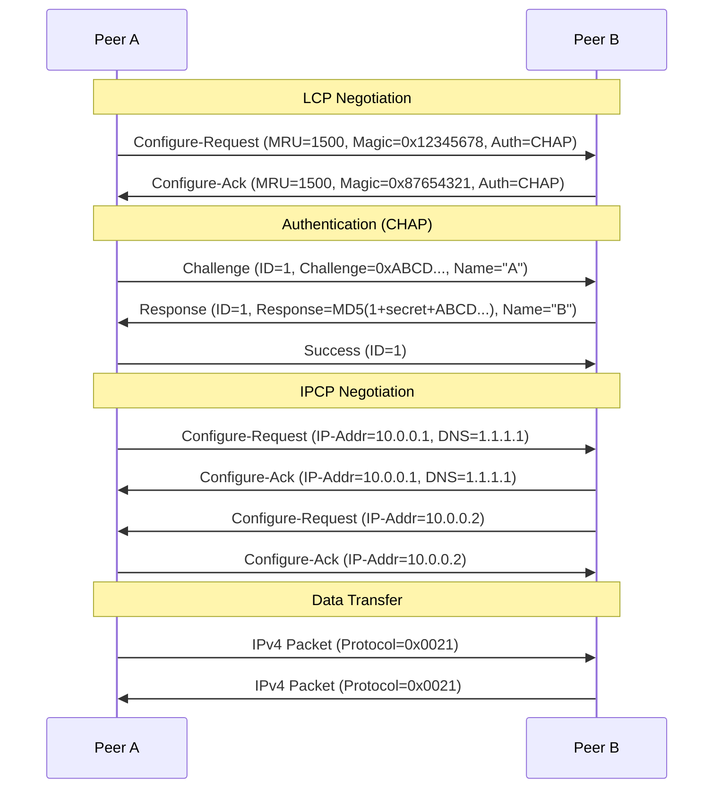

# PPP & HDLC

## What it is
**HDLC (High-Level Data Link Control)** is a bit-oriented synchronous data link layer protocol (ISO 13239) that provides framing, flow control, and error detection via CRC-16 over point-to-point and multipoint links. **PPP (Point-to-Point Protocol)** (RFC 1661, RFC 1662) adapts HDLC framing for asynchronous serial links, adding a link control protocol (LCP) for negotiation, authentication (PAP/CHAP/EAP), and network control protocols (NCPs) for each network layer protocol (IPCP, IPv6CP, etc.).

## Why it matters
PPP remains the standard for dial-up, DSL (PPPoE), VPN tunnels (L2TP/PPTP), and serial WAN links; understanding its frame structure, LCP state machine, and NCP negotiation is essential for debugging link establishment failures, MTU/MRU mismatches, and authentication issues in production networks.

## How it actually works

### HDLC Frame Structure (ISO 13239)
```
Flag (0x7E) | Address (8-bit) | Control (8/16-bit) | Information (variable) | FCS (16-bit CRC-CCITT) | Flag (0x7E)
```
- **Flag**: `0x7E` (01111110) — delimiting sequence; bit stuffing ensures transparency: after five consecutive `1` bits, a `0` is inserted by transmitter and removed by receiver.
- **Address**: `0xFF` (all-stations) for point-to-point; secondary station address for multipoint.
- **Control**: 8-bit (basic) or 16-bit (extended) field defining frame type:
  - **I-frames** (Information): `N(S)` send sequence, `N(R)` receive sequence, `P/F` poll/final bit.
  - **S-frames** (Supervisory): RR, RNR, REJ, SREJ for flow/error control.
  - **U-frames** (Unnumbered): SABM, DISC, UA, DM, FRMR, UI for link management.
- **FCS**: CRC-16-CCITT (polynomial `x^16 + x^12 + x^5 + 1`, initial value `0xFFFF`, no reflection, final XOR `0x0000`).

### PPP Framing (RFC 1662) — Asynchronous HDLC
PPP uses HDLC-like framing with **byte stuffing** (not bit stuffing) for async links:
```
Flag (0x7E) | Address (0xFF) | Control (0x03) | Protocol (16-bit) | Information | FCS (16/32-bit) | Flag (0x7E)
```
- **Address/Control**: Fixed `0xFF 0x03` (UI-frame) — compressed via LCP Address-and-Control-Field-Compression (ACFC) option.
- **Protocol**: 16-bit field (high bit of first octet = 0 for LCP/NCPs, 1 for network protocols). Compressed to 8-bit via LCP Protocol-Field-Compression (PFC) when high byte is `0x00`.
- **Escaping**: `0x7D` (ESC) followed by original byte XOR `0x20`:
  - `0x7E` → `0x7D 0x5E`
  - `0x7D` → `0x7D 0x5D`
  - Any `0x00-0x1F` (control chars) → `0x7D (byte^0x20)` (configurable via Async-Control-Character-Map)
- **FCS**: Default CRC-16-CCITT (same as HDLC); CRC-32 (polynomial `0x04C11DB7`) negotiated via LCP.

### LCP (Link Control Protocol) — RFC 1661
LCP packets carried in PPP frames with **Protocol = 0xC021**. State machine: `Initial → Starting → Req-Sent → Ack-Rcvd → Ack-Sent → Opened` (or `Closing → Stopping → Closed`).
- **Packet types**: Configure-Request (1), Configure-Ack (2), Configure-Nak (3), Configure-Reject (4), Terminate-Request (5), Terminate-Ack (6), Code-Reject (7), Protocol-Reject (8), Echo-Request (9), Echo-Reply (10), Discard-Request (11).
- **Magic Number** (Option 5): 32-bit random value for loopback detection; echoed in Configure-Ack.
- **MRU** (Option 1): Default 1500 octets; max negotiated value.
- **ACFC** (Option 2): Allow omission of `0xFF 0x03`.
- **PFC** (Option 3): Allow 8-bit Protocol field when high byte `0x00`.
- **Async-Control-Character-Map** (Option 4): 32-bit bitmap of control chars to escape (default `0xFFFFFFFF` = escape all `0x00-0x1F`).
- **Authentication-Protocol** (Option 3): `0xC023` = PAP, `0xC223` = CHAP, `0xC227` = EAP.

### Authentication
- **PAP** (RFC 1334): 2-way handshake; credentials sent in cleartext (Protocol `0xC023`). Packet: Authenticate-Request (1) → Authenticate-Ack (2) / Authenticate-Nak (3).
- **CHAP** (RFC 1994): 3-way challenge-response; Protocol `0xC223`. Challenge (1) → Response (2) → Success (3) / Failure (4). Uses MD5: `Response = MD5(Identifier + Secret + Challenge)`.
- **EAP** (RFC 3748): Extensible framework; PPP carries EAP packets (Protocol `0xC227`).

### NCP (Network Control Protocols)
Each network layer runs its own NCP over PPP (Protocol field values):
- **IPCP** (RFC 1332): Protocol `0x8021`. Options: IP-Address (3), Primary/Secondary DNS (129/131), Primary/Secondary NBNS (130/132). Negotiates local/peer IPv4 addresses.
- **IPv6CP** (RFC 5072): Protocol `0x8057`. Options: Interface-Identifier (1), IPv6-Compression-Protocol (2). Uses EUI-64 or random IID.
- **OSINLCP**, **IPXCP**, **ATCP**, **CCP** (Compression Control Protocol, RFC 1962) for MPPC, STAC-LZS, etc.

### Link Establishment Sequence
1. **LCP Open**: Exchange Configure-Requests until both sides Ack; negotiate MRU, ACFC, PFC, ACCM, Magic Number, Auth.
2. **Authentication** (if negotiated): PAP/CHAP/EAP exchange.
3. **NCP Open**: Per-protocol (IPCP, IPv6CP) Configure-Request/Ack until Opened.
4. **Data Transfer**: Network layer packets encapsulated with negotiated Protocol field.
5. **Termination**: LCP Terminate-Request/Ack tears down all NCPs and link.

### PPPoE (RFC 2516)
Encapsulates PPP frames in Ethernet:
- **Discovery Stage**: PADI (broadcast) → PADO (unicast) → PADR (unicast) → PADS (session confirmation, assigns Session-ID).
- **Session Stage**: Ethernet type `0x8864`; PPP frames with Session-ID (16-bit) replace Flags.
- **MTU**: 1492 bytes (Ethernet 1500 - 6 PPPoE header - 2 PPP Protocol).

## Architecture / flow


## Key terms
**Bit stuffing** — HDLC transparency mechanism: transmitter inserts `0` after five consecutive `1` bits; receiver removes it.
**Byte stuffing** — PPP async transparency: `0x7D` escape + (byte XOR `0x20`) for flag, escape, and control characters.
**Magic Number** — 32-bit random LCP option (Option 5) used to detect looped-back links; must differ between peers.
**MRU** — Maximum Receive Unit; default 1500 octets, negotiated via LCP Option 1; distinct from MTU (layer 3).
**ACCM** — Async-Control-Character-Map (LCP Option 4); 32-bit bitmap indicating which `0x00-0x1F` chars require escaping.
**NCP** — Network Control Protocol; per-protocol (IPCP, IPv6CP) state machine running after LCP/Open and authentication.

## Example
```bash
# pppd options for a typical serial link with CHAP auth, MRU 1492, header compression
/dev/ttyS0 115200 crtscts modem noipdefault \
  usepeerdns defaultroute \
  mru 1492 mtu 1492 \
  lcp-echo-interval 30 lcp-echo-failure 4 \
  +chap -pap \
  name "myusername" \
  password "mysecret" \
  nodefaultroute
```
Demonstrates: MRU/MTU for PPPoE (1492), CHAP-only auth, LCP keepalives (echo every 30s, 4 failures = drop), header compression defaults (ACFC/PFC enabled).

## Common mistakes
- **Assuming MRU = MTU**: MRU is link-layer receive limit; MTU is layer-3 packet size. PPP adds 2-4 bytes (Protocol + optional FCS); IP MTU must be ≤ MRU - 2.
- **Forgetting ACCM negotiation**: Default `0xFFFFFFFF` escapes all control chars; if peer sends raw `0x11` (XON) and ACCM doesn't match, frame corruption occurs silently.
- **Using PAP over untrusted links**: Credentials transmitted in cleartext; CHAP or EAP required for security.
- **Ignoring Magic Number collisions**: If both peers generate same 32-bit Magic (probability ~1/2^32), loopback detection fails; regenerate on collision per RFC 1661 §5.6.

## Lesser-known internals
- **Protocol-Reject handling**: If peer sends unknown Protocol (e.g., `0x003D` for MPLS), receiver must send Protocol-Reject (LCP Code 8); sender must stop using that protocol — not optional.
- **FCS-32 vs FCS-16**: PPP defaults to CRC-16; CRC-32 negotiated via LCP Option 6. CRC-32 detects more burst errors but costs 2 extra bytes/frame; rarely used on modern links.
- **LCP Echo-Request as keepalive**: Not a heartbeat — only verifies link *bidirectional* connectivity. If peer A sends Echo-Request and peer B replies, A knows *both* directions work. Unidirectional failure (e.g., fiber cut one strand) detected only by this mechanism.

## Topics to explore further
- **MLPPP (Multilink PPP, RFC 1990)**: Fragmentation/reassembly across multiple physical links; sequence numbers in PPP header.
- **PPP over SONET/SDH (RFC 2615)**: HDLC-like framing with K1/K2 bytes for APS signaling; used in carrier backbones.
- **L2TPv3 (RFC 3931)**: PPP session tunneling over IP; pseudowire control plane replaces LCP/NCP.
- **HDLC NRM/ARM/ABM modes**: Normal/Asynchronous/Balanced Response Modes for multipoint polling; relevant for legacy SCADA/telemetry.

## Learn next
- **PPPoE / PPPoA** — Direct encapsulation of PPP over Ethernet/ATM; DSL/FTTx deployment standard
- **L2TP / IPsec** — VPN tunneling protocols that carry PPP sessions; enterprise remote access
- **HDLC derivatives (SDLC, LAPB, LAPD)** — Bit-oriented framing in X.25, ISDN, SS7; telecom signaling internals