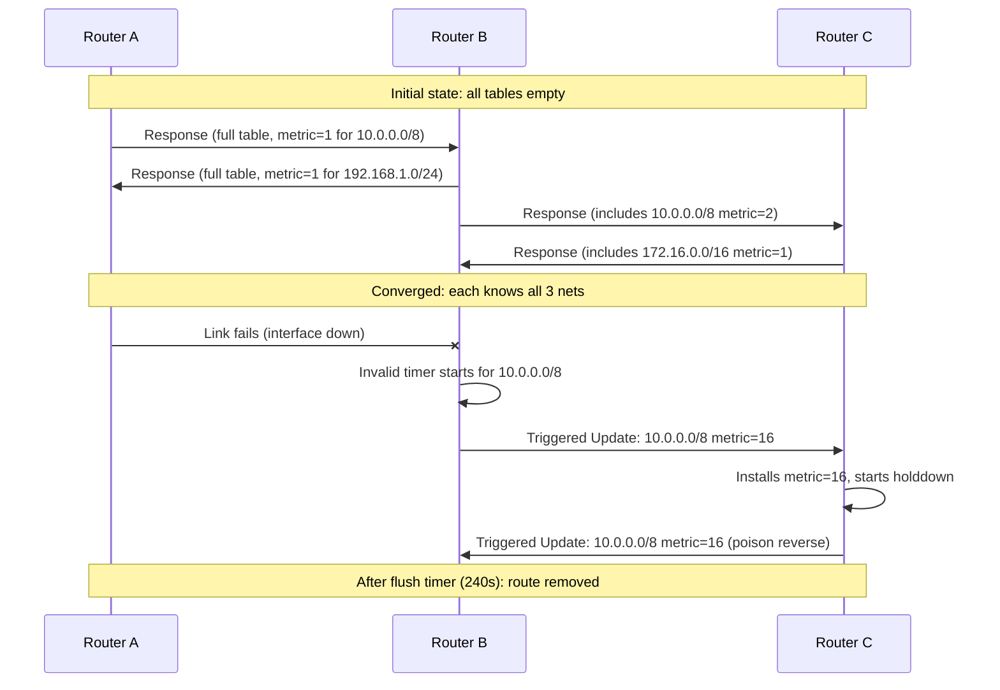

# RIP — Routing Information Protocol

## What it is
RIP is a **distance-vector routing protocol** that uses **hop count** as its sole metric to determine the best path to a destination network. It operates at the application layer over **UDP port 520**, exchanging routing tables with directly connected neighbors every 30 seconds. RIPv1 is classful (no subnet mask support); RIPv2 adds classless routing, multicast updates, and authentication.

## Why it matters
Developers encounter RIP when debugging legacy network infrastructure, implementing routing daemons (e.g., FRR, Quagga, BIRD), or troubleshooting convergence issues in small/homogeneous networks where RIP persists due to zero-configuration simplicity.

## How it actually works

### Algorithm & Metric
RIP implements the **Bellman-Ford algorithm** (distributed variant). Each router maintains a distance vector: for every known destination, it stores the **next-hop IP**, **egress interface**, and **metric (hop count)**. Metric = 1 per router hop; **maximum metric = 15**, **16 = unreachable (infinity)**. This hard limit constrains network diameter to ≤15 hops.

**Time complexity**: O(N·D) per full convergence cycle where N = number of routes, D = network diameter (in hops). **Space complexity**: O(N) per router for the routing table.

### Timers (RFC 2453 §3.2)
| Timer | Default | Purpose |
|-------|---------|---------|
| **Update** | 30 s | Periodic full table broadcast/multicast |
| **Invalid** | 180 s | Route marked unreachable if no update received |
| **Holddown** | 180 s | Suppresses new routes to same destination after invalidation |
| **Flush** | 240 s | Route removed from table after holddown expires |

Jitter: implementations **must** add ±0–15% random offset to update timer to prevent synchronization collapse (RFC 2453 §3.3).

### RIPv2 Packet Format (RFC 2453 §4)
```
 0                   1                   2                   3
 0 1 2 3 4 5 6 7 8 9 0 1 2 3 4 5 6 7 8 9 0 1 2 3 4 5 6 7 8 9 0 1
+-+-+-+-+-+-+-+-+-+-+-+-+-+-+-+-+-+-+-+-+-+-+-+-+-+-+-+-+-+-+-+-+
| Command (1)   | Version (1)   |         Zero (2)              |
+-+-+-+-+-+-+-+-+-+-+-+-+-+-+-+-+-+-+-+-+-+-+-+-+-+-+-+-+-+-+-+-+
| Address Family Identifier (2) |     Route Tag (2)             |
+-+-+-+-+-+-+-+-+-+-+-+-+-+-+-+-+-+-+-+-+-+-+-+-+-+-+-+-+-+-+-+-+
|                        IP Address (4)                         |
+-+-+-+-+-+-+-+-+-+-+-+-+-+-+-+-+-+-+-+-+-+-+-+-+-+-+-+-+-+-+-+-+
|                        Subnet Mask (4)                        |
+-+-+-+-+-+-+-+-+-+-+-+-+-+-+-+-+-+-+-+-+-+-+-+-+-+-+-+-+-+-+-+-+
|                        Next Hop (4)                           |
+-+-+-+-+-+-+-+-+-+-+-+-+-+-+-+-+-+-+-+-+-+-+-+-+-+-+-+-+-+-+-+-+
|                        Metric (4)                             |
+-+-+-+-+-+-+-+-+-+-+-+-+-+-+-+-+-+-+-+-+-+-+-+-+-+-+-+-+-+-+-+-+
```
- **Command**: 1 = Request, 2 = Response
- **Version**: 2 for RIPv2
- **AFI**: 2 = IP (AF_INET); 0xFFFF in first entry of Request = "send full table"
- **Route Tag**: 2 bytes, opaque (used for redistribution filtering)
- **Subnet Mask**: enables CIDR/VLSM (RIPv1 has zeros here)
- **Next Hop**: 0.0.0.0 = advertising router is next hop
- **Metric**: 1–16 (16 = unreachable)
- **Max 25 route entries per packet** (20 bytes each + 4-byte header = 504 bytes, fits in 512-byte UDP payload)

### Loop Prevention Mechanisms
1. **Split Horizon** (RFC 2453 §3.4): Never advertise a route back out the interface it was learned from.
2. **Poison Reverse** (optional, RFC 2453 §3.4): Advertise learned routes back with metric 16 (unreachable) to explicitly break loops faster.
3. **Holddown Timer**: After a route becomes invalid, ignore new advertisements for that destination for 180s to prevent flapping.
4. **Triggered Updates** (RFC 2453 §3.3): Immediately send partial update when metric changes (not just periodic), accelerating convergence.

### RIPv1 vs RIPv2 Differences
| Feature | RIPv1 | RIPv2 |
|---------|-------|-------|
| Addressing | Classful (A/B/C) | Classless (CIDR/VLSM) |
| Subnet Mask | Not carried | Carried in each entry |
| Update Destination | Broadcast 255.255.255.255 | Multicast **224.0.0.9** |
| Authentication | None | Simple password or MD5 (RFC 2453 §5) |
| Next Hop Field | Always 0 | Populated for multi-access nets |
| Route Tag | Not present | 16-bit opaque tag |

### Authentication (RIPv2 only)
- **Simple Password**: 16-byte plaintext in first route entry (AFI=0xFFFF, metric=2)
- **MD5**: Keyed HMAC-MD5 over entire RIP packet + key; Key ID (1 byte), Auth Data Length (1 byte), Sequence Number (4 bytes), zero-padded to 16 bytes. Defined in RFC 2453 §5; **not cryptographically strong by modern standards**.

### Convergence Behavior
- **Count-to-infinity**: Without split horizon/poison reverse, a failed route increments metric by 1 per update cycle until 16 (max 2.5 minutes with 30s updates).
- **Convergence time**: ~D × 30s worst-case (D = diameter) with triggered updates; up to 180s+ without.

## Architecture / flow



## Key terms
- **Distance Vector** — Routing algorithm where each router shares its entire distance-to-destination vector with neighbors; Bellman-Ford distributed implementation.
- **Split Horizon** — Loop prevention: a router never advertises a route back out the interface from which it was learned.
- **Poison Reverse** — Enhanced split horizon: advertise learned routes back with metric 16 to explicitly signal unreachability.
- **Holddown Timer** — Period (default 180s) after route invalidation during which new advertisements for that destination are ignored.
- **Route Tag** — 16-bit opaque field in RIPv2 entries used to carry redistribution metadata (e.g., OSPF tag) across RIP domain.
- **Triggered Update** — Immediate partial routing update sent when a route metric changes, not waiting for periodic timer.

## Example
```bash
# FRR (Free Range Routing) RIPv2 config with MD5 auth
router rip
 version 2
 network 10.0.0.0/8
 network 192.168.1.0/24
 passive-interface eth0
 redistribute connected
 key-chain RIP_KEYS
!
key-chain RIP_KEYS
 key 1
  key-string s3cr3tK3y
  accept-lifetime 00:00:00 Jan 1 2024 infinite
  send-lifetime 00:00:00 Jan 1 2024 infinite
```
Enables RIPv2 on two networks, suppresses updates on `eth0`, redistributes connected routes, and applies MD5 authentication using key ID 1.

## Common mistakes
1. **Assuming RIPv1 supports VLSM/CIDR** — it ignores subnet masks; mixing RIPv1 and RIPv2 on same segment causes silent route corruption.
2. **Forgetting `version 2` in config** — defaults to RIPv1 on many daemons (Cisco IOS, FRR), resulting in broadcast updates and no subnet masks.
3. **Setting metric >15 on redistribution** — routes with metric 16 are unreachable; common when redistributing OSPF (default metric 20) without `default-metric 1-15`.
4. **Disabling split horizon on NBMA (Frame Relay, DMVPN) without poison reverse** — creates persistent routing loops; must use `no ip split-horizon` + `ip rip poison-reverse` or subinterfaces.

## Lesser-known internals
- **Request packet with AFI=0xFFFF, metric=16** means "send full table" — but the metric field is **ignored** by receiver; it's a historical artifact from RIPv1.
- **Next Hop field ≠ 0.0.0.0** only used on multi-access networks (Ethernet) when advertising router is not the optimal next hop (e.g., RIP router learning from OSPF neighbor on same LAN). Most implementations **ignore non-zero next hop** unless explicitly configured.
- **Route Tag is not propagated by default** across RIP domain boundaries — must configure `redistribute rip metric transparent` (or equivalent) to preserve tags for route-map filtering downstream.

## Topics to explore further
- **RIPng (RFC 2080)** — IPv6 extension using UDP port 521, multicast FF02::9, 128-bit prefixes, no authentication field (relies on IPsec).
- **BFD (Bidirectional Forwarding Detection) for RIP** — sub-second failure detection replacing 180s invalid timer; requires daemon support (FRR, BIRD).
- **RIP/OSPF redistribution metrics** — `default-metric`, `metric-type`, and tag propagation semantics when connecting RIP domains to link-state protocols.

## Learn next
- **OSPF (Open Shortest Path First)** — Link-state protocol replacing RIP in enterprise; understanding RIP's limitations (hop count, slow convergence) motivates OSPF's design.
- **BGP (Border Gateway Protocol)** — Path-vector protocol for inter-domain routing; RIP's route tag and redistribution concepts map directly to BGP communities and MED.
- **Routing Protocol Convergence Analysis** — Mathematical models (Markov chains, graph diameter) for quantifying RIP vs OSPF vs IS-IS convergence under failure scenarios.