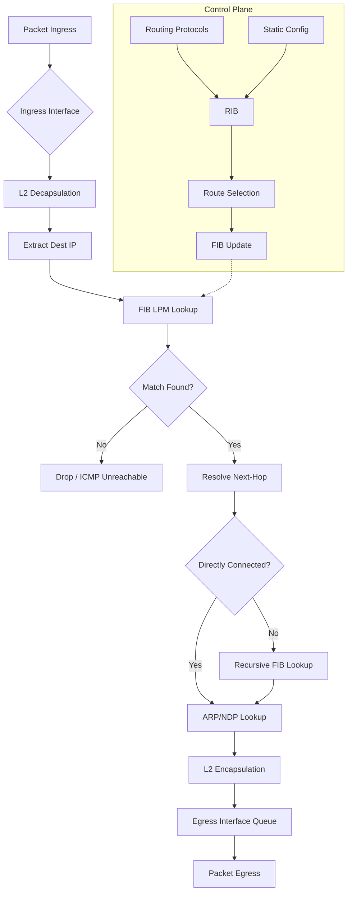

# Routing Concepts

## What it is
Routing is the process of selecting paths in a network for forwarding packets from source to destination based on destination IP address. A router maintains a routing table mapping destination prefixes to next-hop interfaces, and uses longest prefix match (LPM) to determine the most specific route for each packet.

## Why it matters
Every networked application depends on correct routing; misconfigured routes cause black holes, asymmetry, or suboptimal paths that manifest as latency, timeouts, or security exposure. Understanding routing internals is essential for debugging connectivity, designing scalable topologies, and implementing policy-based forwarding.

## How it actually works

### Routing table structure
A routing table entry (RIB entry) contains:
- **Destination prefix**: IPv4/IPv6 network in CIDR notation (e.g., `192.168.1.0/24`)
- **Next hop**: IP address of the next router or `0.0.0.0` for directly connected
- **Outgoing interface**: Local interface index (e.g., `eth0`, `GigabitEthernet0/0`)
- **Metric**: Cost value used for path selection (protocol-specific)
- **Administrative distance (AD)**: Trustworthiness of the route source (lower = preferred)
- **Route source**: Protocol that installed the route (connected, static, OSPF, BGP, etc.)

### Longest Prefix Match (LPM) algorithm
When forwarding a packet, the router performs LPM on the destination IP against all prefixes in the routing table. The algorithm:
1. Extracts destination IP from packet header
2. Searches routing table for all prefixes where `(dest_ip & prefix_mask) == prefix_network`
3. Selects the match with the **longest prefix length** (most specific)
4. If multiple equal-length matches exist, selects by lowest AD, then lowest metric

**Time complexity**: O(W) where W = address width (32 for IPv4, 128 for IPv6) using trie-based data structures (Patricia trie, LPC-trie). Linux kernel uses **LPC-trie** (Level and Path Compressed trie) with O(W) worst-case, typically 3-4 memory accesses per lookup.

### Static routing
Manually configured routes with explicit next-hop or interface. AD = 1 (Cisco) or 0 (Linux `ip route`). No protocol overhead, no convergence delay. Used for:
- Default routes (`0.0.0.0/0` or `::/0`)
- Stub networks
- Management traffic isolation
- Overriding dynamic routes for policy

### Dynamic routing protocols
Classified by scope and algorithm:

| Protocol | Type | Algorithm | AD (Cisco) | Port | RFC |
|----------|------|-----------|------------|------|-----|
| **RIPv2** | Distance Vector | Bellman-Ford | 120 | UDP 520 | RFC 2453 |
| **OSPFv2** | Link State | Dijkstra SPF | 110 | IP 89 | RFC 2328 |
| **OSPFv3** | Link State | Dijkstra SPF | 110 | IP 89 | RFC 5340 |
| **IS-IS** | Link State | Dijkstra SPF | 115 | CLNP | RFC 1195 |
| **BGPv4** | Path Vector | Policy-based | 20 (eBGP), 200 (iBGP) | TCP 179 | RFC 4271 |
| **EIGRP** | Hybrid (DUAL) | DUAL finite state machine | 90 (internal), 170 (external) | IP 88 | Cisco proprietary |

#### Distance Vector (RIP)
- Routers exchange full routing tables with neighbors every 30 seconds (RIPv2)
- Metric = hop count (max 15; 16 = unreachable)
- Slow convergence, count-to-infinity problem mitigated by split horizon, poison reverse, holddown timers
- **Complexity**: O(N×E) per update where N = routers, E = links

#### Link State (OSPF, IS-IS)
- Each router floods Link State Advertisements (LSAs/LSPs) describing local links
- All routers build identical Link State Database (LSDB)
- Each router runs **Dijkstra SPF** independently to compute shortest-path tree
- **SPF complexity**: O(E + V log V) with Fibonacci heap; O(E log V) with binary heap
- Areas (OSPF) / Levels (IS-IS) limit LSDB scope and SPF computation

#### Path Vector (BGP)
- Exchanges full path (AS_PATH) to prevent loops
- Policy-driven: route selection uses ordered attributes:
  1. Weight (Cisco local)
  2. Local Preference
  3. Locally originated
  4. Shortest AS_PATH
  5. Lowest ORIGIN type (IGP < EGP < INCOMPLETE)
  6. Lowest MED
  7. eBGP > iBGP
  8. Lowest IGP metric to NEXT_HOP
  9. Oldest route (stability)
  10. Lowest Router ID
- **TCP 179** for reliable transport; keepalives every 60s default

### Route installation and FIB
1. **RIB (Routing Information Base)**: Control-plane database holding all learned routes
2. **Route selection**: Per-prefix best path chosen by AD → metric → tie-breakers
3. **FIB (Forwarding Information Base)**: Data-plane optimized copy of selected routes for LPM lookup
4. **Adjacency table**: Maps next-hop IP to Layer 2 rewrite header (MAC addresses)

Linux kernel: `fib_table` (RIB) → `fib_info` → `fib_nh` (next hops) → `fib_alias` → FIB trie. `ip route show` displays RIB; `ip route get` shows FIB lookup result.

### Administrative Distance defaults (Cisco)
| Source | AD |
|--------|-----|
| Connected | 0 |
| Static | 1 |
| EIGRP summary | 5 |
| External BGP | 20 |
| Internal EIGRP | 90 |
| IGRP | 100 |
| OSPF | 110 |
| IS-IS | 115 |
| RIP | 120 |
| External EIGRP | 170 |
| Internal BGP | 200 |
| Unknown | 255 |

## Architecture / flow



## Key terms
**RIB (Routing Information Base)** — Control-plane database containing all routes learned from all protocols before best-path selection.
**FIB (Forwarding Information Base)** — Data-plane optimized table derived from RIB, structured for hardware-accelerated LPM lookup.
**Administrative Distance** — Numeric value (0-255) ranking route source trustworthiness; lower values preferred during best-path selection.
**Longest Prefix Match (LPM)** — Forwarding algorithm selecting the route with the most specific (longest) matching prefix for a destination IP.
**AS_PATH** — BGP attribute listing autonomous systems traversed; primary loop prevention and path selection mechanism.
**Recursive Lookup** — Process where a route's next-hop IP is not directly connected, requiring another FIB lookup to resolve egress interface.

## Example
```bash
# Linux iproute2: static route with explicit next-hop and metric
ip route add 10.0.0.0/8 via 192.168.1.1 dev eth0 metric 100

# Cisco IOS: static route with AD override (floating static)
ip route 10.0.0.0 255.0.0.0 192.168.1.1 254

# Verify FIB lookup result for a destination
ip route get 10.10.10.10
```
Demonstrates static route configuration with metric/AD and FIB lookup verification showing actual forwarding decision.

## Common mistakes
- **Assuming AD applies across vendors**: Linux `ip route` uses metric only; AD is a Cisco/Juniper concept. Linux prefers lower metric regardless of source.
- **Configuring overlapping static routes without metrics**: Equal-length prefixes with same metric cause ECMP hashing, not deterministic failover.
- **Forgetting recursive resolution**: A static route `via 10.1.1.1` fails silently if `10.1.1.1` has no route in RIB — no ICMP generated until packet arrives.
- **Misunderstanding BGP NEXT_HOP behavior**: In iBGP, NEXT_HOP is not modified; requires IGP reachability or `next-hop-self` on route reflector.

## Lesser-known internals
- **LPC-trie null routes**: Linux installs `/32` host routes for local IPs in FIB with `RTN_LOCAL` type; these bypass LPM and trap to control plane for termination.
- **BGP route reflector cluster IDs**: Prevent loops in reflector hierarchies; `CLUSTER_LIST` attribute accumulates reflector IDs — if own cluster ID seen, route discarded.
- **OSPF LSA aging and refresh**: LSAs age to MaxAge (3600s); originator must refresh every 1800s (LSRefreshTime). Premature aging (set to MaxAge) triggers immediate SPF.

## Topics to explore further
- **ECMP hashing algorithms**: Per-flow vs per-packet, 5-tuple hashing, symmetric hashing for bidirectional flows
- **BGP communities and extended communities**: Policy signaling (NO_EXPORT, NO_ADVERTISE, RT for VPNs)
- **Segment Routing (SR-MPLS, SRv6)**: Source routing replacing LDP/RSVP-TE; SID allocation and forwarding
- **VRF / VRF-Lite**: Multiple routing tables on single router; route leaking between VRFs

## Learn next
- **BGP Path Selection & Policy** — Directly builds on routing table concepts; BGP is the internet's routing protocol
- **OSPF/IS-IS Internals** — Link-state mechanics, LSDB synchronization, SPF optimization, area design
- **Linux Kernel Networking Stack** — Netfilter, routing cache (deprecated), FIB trie implementation, XDP/BPF integration