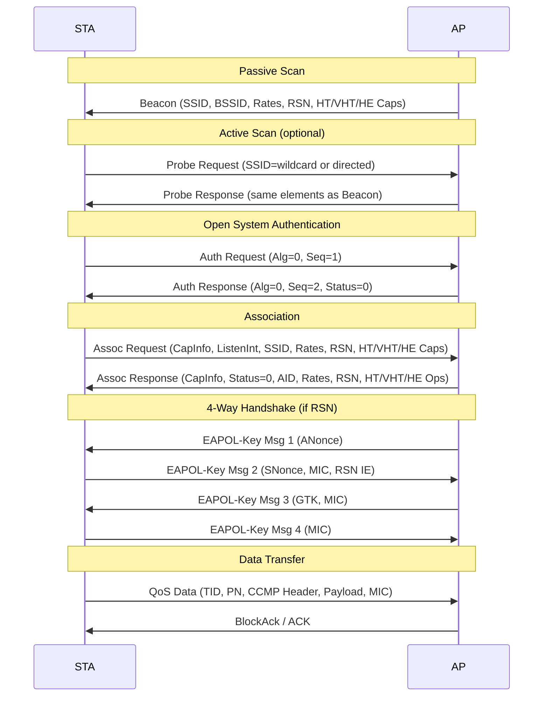

# Wi-Fi at the Data Link Layer

## What it is
IEEE 802.11 defines the MAC and PHY specifications for wireless LANs operating in the 2.4, 5, and 6 GHz bands. At the Data Link Layer, the 802.11 MAC sublayer provides framing, addressing, channel access via CSMA/CA, fragmentation/reassembly, and encryption via CCMP/GCMP. Stations (STAs) communicate within a Basic Service Set (BSS) identified by a BSSID, typically the AP's MAC address.

## Why it matters
Developers working on embedded firmware, network drivers, packet capture analysis, or location-aware applications must understand 802.11 frame structure and the association state machine to debug connectivity failures, optimize roaming, or implement custom management frame handling.

## How it actually works

### 802.11 MAC Frame Format
Every 802.11 frame consists of a **MAC Header** (24–30 bytes), variable-length **Frame Body**, and 4-byte **FCS (CRC-32)**. The MAC Header structure:

```
 0                   1                   2                   3
 0 1 2 3 4 5 6 7 8 9 0 1 2 3 4 5 6 7 8 9 0 1 2 3 4 5 6 7 8 9 0 1
+-+-+-+-+-+-+-+-+-+-+-+-+-+-+-+-+-+-+-+-+-+-+-+-+-+-+-+-+-+-+-+-+
| Frame Control | Duration/ID   | Address 1 (RA)                |
+-+-+-+-+-+-+-+-+-+-+-+-+-+-+-+-+-+-+-+-+-+-+-+-+-+-+-+-+-+-+-+-+
| Address 1 (cont)            | Address 2 (TA)                  |
+-+-+-+-+-+-+-+-+-+-+-+-+-+-+-+-+-+-+-+-+-+-+-+-+-+-+-+-+-+-+-+-+
| Address 2 (cont)            | Address 3 (BSSID/DA/SA)         |
+-+-+-+-+-+-+-+-+-+-+-+-+-+-+-+-+-+-+-+-+-+-+-+-+-+-+-+-+-+-+-+-+
| Address 3 (cont)            | Sequence Control | Address 4    |
+-+-+-+-+-+-+-+-+-+-+-+-+-+-+-+-+-+-+-+-+-+-+-+-+-+-+-+-+-+-+-+-+
| Address 4 (cont)            | QoS Control | HT Control        |
+-+-+-+-+-+-+-+-+-+-+-+-+-+-+-+-+-+-+-+-+-+-+-+-+-+-+-+-+-+-+-+-+
```

**Frame Control (2 bytes)** bit layout:
- Bits 0–1: **Protocol Version** = `00` (only value defined)
- Bits 2–3: **Type** — `00` Management, `01` Control, `10` Data, `11` Reserved
- Bits 4–7: **Subtype** — e.g., `1000` Beacon, `0100` Probe Request, `1011` QoS Data
- Bits 8–15: **Flags** — ToDS, FromDS, MoreFrag, Retry, PwrMgt, MoreData, Protected, Order

**Address fields** (6 bytes each) interpretation depends on ToDS/FromDS:
| ToDS | FromDS | Addr1 (RA) | Addr2 (TA) | Addr3 | Addr4 |
|------|--------|------------|------------|-------|-------|
| 0    | 0      | DA         | SA         | BSSID | N/A   |
| 0    | 1      | DA         | BSSID      | SA    | N/A   |
| 1    | 0      | BSSID      | SA         | DA    | N/A   |
| 1    | 1      | RA         | TA         | DA    | SA    |

**Sequence Control (2 bytes)**: 4-bit Fragment Number (LSB) + 12-bit Sequence Number (MSB). Incremented per MSDU, not per fragment.

**QoS Control (2 bytes)**: Present only in QoS Data frames. Bits 0–3: TID (0–7), Bit 4: EOSP, Bits 5–7: Reserved, Bits 8–15: TXOP Duration.

### SSID and BSSID
- **SSID** (Service Set Identifier): 0–32 octets, carried in **Tagged Parameter** Element ID `0` (SSID Parameter Set) in Beacon, Probe Response, Association Request, Reassociation Request. Length `0` in Probe Request = wildcard (broadcast SSID).
- **BSSID** (Basic Service Set Identifier): 48-bit MAC address. In infrastructure BSS, equals the AP's radio MAC. In IBSS (ad-hoc), locally administered bit (U/L) set to 1, derived from random value. Carried in Address 3 of Beacon/Probe Response frames and in the **BSSID field** of Association Request.

### Association Process (State Machine)
1. **Scanning**
   - **Passive**: STA listens on each channel for Beacon frames (interval typically 100 TU = 102.4 ms). Beacon contains: Timestamp, Beacon Interval, Capability Information, SSID, Supported Rates, DS Parameter Set (channel), TIM, RSN/RSNXE.
   - **Active**: STA transmits **Probe Request** (Subtype `0100`) with optional SSID element (wildcard or directed). AP responds with **Probe Response** (Subtype `0101`) containing same elements as Beacon.

2. **Authentication** (Open System or Shared Key — legacy; 802.1X/EAP handled post-association)
   - STA → AP: **Authentication Request** (Seq 1, Algorithm=0 Open System)
   - AP → STA: **Authentication Response** (Seq 2, Status Code=0 Success)

3. **Association**
   - STA → AP: **Association Request** containing:
     - Capability Information (2 bytes): ESS, IBSS, CF-Pollable, CF-PollReq, Privacy, Short Preamble, PBCC, Channel Agility, Spectrum Mgmt, QoS, Short Slot Time, APSD, Radio Measurement, DSSS-OFDM, Delayed Block Ack, Immediate Block Ack
     - Listen Interval (2 bytes): Beacon intervals STA sleeps between
     - SSID Element (ID 0)
     - Supported Rates (ID 1) / Extended Supported Rates (ID 50)
     - RSN Element (ID 48) for WPA2/WPA3: Version=1, Group Cipher Suite, Pairwise Cipher Suite Count + List, AKM Suite Count + List, RSN Capabilities
     - HT Capabilities (ID 45), VHT Capabilities (ID 191), HE Capabilities (ID 255/Ext ID 35) for 802.11n/ac/ax
   - AP → STA: **Association Response** containing:
     - Capability Information
     - Status Code (0=Success, 1=Unspecified, 10=Cannot support all capabilities, 11=Reassociation denied, 12=Association denied unsupported rates, 13=Association denied no short preamble, 14=Association denied no PBCC, 15=Association denied no channel agility, 16=Association denied no spectrum mgmt, 17=Association denied bad power capability, 18=Association denied bad supported channels, 19=Association denied no short slot time, 20=Association denied no DSSS-OFDM, 21=Association denied no HT, 22=Association denied no VHT, 23=Association denied no HE, 24=Association denied no EHT, 25=Association denied no MLO, 26=Association denied no RNR, 27=Association denied no MBO, 28=Association denied no FILS, 29=Association denied no OWE, 30=Association denied no SAE, 31=Association denied no FILS+SAE, 32=Association denied no OWE+SAE, 33=Association denied no FILS+OWE, 34=Association denied no SAE+OWE, 35=Association denied no FILS+SAE+OWE, 36=Association denied no MLO, 37=Association denied no RNR, 38=Association denied no MBO, 39=Association denied no FILS, 40=Association denied no OWE, 41=Association denied no SAE, 42=Association denied no FILS+SAE, 43=Association denied no OWE+SAE, 44=Association denied no SAE+OWE, 45=Association denied no FILS+SAE+OWE, 46=Association denied no MLO, 47=Association denied no RNR, 48=Association denied no MBO, 49=Association denied no FILS, 50=Association denied no OWE, 51=Association denied no SAE, 52=Association denied no FILS+SAE, 53=Association denied no OWE+SAE, 54=Association denied no SAE+OWE, 55=Association denied no FILS+SAE+OWE, 56=Association denied no MLO, 57=Association denied no RNR, 58=Association denied no MBO, 59=Association denied no FILS, 60=Association denied no OWE, 61=Association denied no SAE, 62=Association denied no FILS+SAE, 63=Association denied no OWE+SAE, 64=Association denied no SAE+OWE, 65=Association denied no FILS+SAE+OWE, 66=Association denied no MLO, 67=Association denied no RNR, 68=Association denied no MBO, 69=Association denied no FILS, 70=Association denied no OWE, 71=Association denied no SAE, 72=Association denied no FILS+SAE, 73=Association denied no OWE+SAE, 74=Association denied no SAE+OWE, 75=Association denied no FILS+SAE+OWE, 76=Association denied no MLO, 77=Association denied no RNR, 78=Association denied no MBO, 79=Association denied no FILS, 80=Association denied no OWE, 81=Association denied no SAE, 82=Association denied no FILS+SAE, 83=Association denied no OWE+SAE, 84=Association denied no SAE+OWE, 85=Association denied no FILS+SAE+OWE, 86=Association denied no MLO, 87=Association denied no RNR, 88=Association denied no MBO, 89=Association denied no FILS, 90=Association denied no OWE, 91=Association denied no SAE, 92=Association denied no FILS+SAE, 93=Association denied no OWE+SAE, 94=Association denied no SAE+OWE, 95=Association denied no FILS+SAE+OWE, 96=Association denied no MLO, 97=Association denied no RNR, 98=Association denied no MBO, 99=Association denied no FILS, 100=Association denied no OWE, 101=Association denied no SAE, 102=Association denied no FILS+SAE, 103=Association denied no OWE+SAE, 104=Association denied no SAE+OWE, 105=Association denied no FILS+SAE+OWE, 106=Association denied no MLO, 107=Association denied no RNR, 108=Association denied no MBO, 109=Association denied no FILS, 110=Association denied no OWE, 111=Association denied no SAE, 112=Association denied no FILS+SAE, 113=Association denied no OWE+SAE, 114=Association denied no SAE+OWE, 115=Association denied no FILS+SAE+OWE, 116=Association denied no MLO, 117=Association denied no RNR, 118=Association denied no MBO, 119=Association denied no FILS, 120=Association denied no OWE, 121=Association denied no SAE, 122=Association denied no FILS+SAE, 123=Association denied no OWE+SAE, 124=Association denied no SAE+OWE, 125=Association denied no FILS+SAE+OWE, 126=Association denied no MLO, 127=Association denied no RNR, 128=Association denied no MBO, 129=Association denied no FILS, 130=Association denied no OWE, 131=Association denied no SAE, 132=Association denied no FILS+SAE, 133=Association denied no OWE+SAE, 134=Association denied no SAE+OWE, 135=Association denied no FILS+SAE+OWE, 136=Association denied no MLO, 137=Association denied no RNR, 138=Association denied no MBO, 139=Association denied no FILS, 140=Association denied no OWE, 141=Association denied no SAE, 142=Association denied no FILS+SAE, 143=Association denied no OWE+SAE, 144=Association denied no SAE+OWE, 145=Association denied no FILS+SAE+OWE, 146=Association denied no MLO, 147=Association denied no RNR, 148=Association denied no MBO, 149=Association denied no FILS, 150=Association denied no OWE, 151=Association denied no SAE, 152=Association denied no FILS+SAE, 153=Association denied no OWE+SAE, 154=Association denied no SAE+OWE, 155=Association denied no FILS+SAE+OWE, 156=Association denied no MLO, 157=Association denied no RNR, 158=Association denied no MBO, 159=Association denied no FILS, 160=Association denied no OWE, 161=Association denied no SAE, 162=Association denied no FILS+SAE, 163=Association denied no OWE+SAE, 164=Association denied no SAE+OWE, 165=Association denied no FILS+SAE+OWE, 166=Association denied no MLO, 167=Association denied no RNR, 168=Association denied no MBO, 169=Association denied no FILS, 170=Association denied no OWE, 171=Association denied no SAE, 172=Association denied no FILS+SAE, 173=Association denied no OWE+SAE, 174=Association denied no SAE+OWE, 175=Association denied no FILS+SAE+OWE, 176=Association denied no MLO, 177=Association denied no RNR, 178=Association denied no MBO, 179=Association denied no FILS, 180=Association denied no OWE, 181=Association denied no SAE, 182=Association denied no FILS+SAE, 183=Association denied no OWE+SAE, 184=Association denied no SAE+OWE, 185=Association denied no FILS+SAE+OWE, 186=Association denied no MLO, 187=Association denied no RNR, 188=Association denied no MBO, 189=Association denied no FILS, 190=Association denied no OWE, 191=Association denied no SAE, 192=Association denied no FILS+SAE, 193=Association denied no OWE+SAE, 194=Association denied no SAE+OWE, 195=Association denied no FILS+SAE+OWE, 196=Association denied no MLO, 197=Association denied no RNR, 198=Association denied no MBO, 199=Association denied no FILS, 200=Association denied no OWE, 201=Association denied no SAE, 202=Association denied no FILS+SAE, 203=Association denied no OWE+SAE, 204=Association denied no SAE+OWE, 205=Association denied no FILS+SAE+OWE, 206=Association denied no MLO, 207=Association denied no RNR, 208=Association denied no MBO, 209=Association denied no FILS, 210=Association denied no OWE, 211=Association denied no SAE, 212=Association denied no FILS+SAE, 213=Association denied no OWE+SAE, 214=Association denied no SAE+OWE, 215=Association denied no FILS+SAE+OWE, 216=Association denied no MLO, 217=Association denied no RNR, 218=Association denied no MBO, 219=Association denied no FILS, 220=Association denied no OWE, 221=Association denied no SAE, 222=Association denied no FILS+SAE, 223=Association denied no OWE+SAE, 224=Association denied no SAE+OWE, 225=Association denied no FILS+SAE+OWE, 226=Association denied no MLO, 227=Association denied no RNR, 228=Association denied no MBO, 229=Association denied no FILS, 230=Association denied no OWE, 231=Association denied no SAE, 232=Association denied no FILS+SAE, 233=Association denied no OWE+SAE, 234=Association denied no SAE+OWE, 235=Association denied no FILS+SAE+OWE, 236=Association denied no MLO, 237=Association denied no RNR, 238=Association denied no MBO, 239=Association denied no FILS, 240=Association denied no OWE, 241=Association denied no SAE, 242=Association denied no FILS+SAE, 243=Association denied no OWE+SAE, 244=Association denied no SAE+OWE, 245=Association denied no FILS+SAE+OWE, 246=Association denied no MLO, 247=Association denied no RNR, 248=Association denied no MBO, 249=Association denied no FILS, 250=Association denied no OWE, 251=Association denied no SAE, 252=Association denied no FILS+SAE, 253=Association denied no OWE+SAE, 254=Association denied no SAE+OWE, 255=Association denied no FILS+SAE+OWE)
     - AID (Association ID): 14 bits (bits 0–13), MSBs set to `11` (value = AID | 0xC000)
     - Supported Rates / Extended Supported Rates
     - RSN Element (if WPA2/WPA3)
     - HT/VHT/HE Operation Elements

### CSMA/CA and DCF
- **DIFS** (DCF Interframe Space) = SIFS + 2×SlotTime (e.g., 34 μs for 802.11a/g/n/ac 20 MHz)
- **SIFS** (Short IFS) = 16 μs (802.11a/g/n/ac), 10 μs (802.11b)
- **SlotTime** = 9 μs (OFDM), 20 μs (DSSS/HR-DSSS)
- **CWmin** = 15 (a/g/n/ac), 31 (b); **CWmax** = 1023
- Backoff counter drawn uniformly from `[0, CW]`, decremented per idle slot. Transmission when counter reaches 0.
- **ACK** sent after SIFS for unicast data/management frames. No ACK for broadcast/multicast.
- **RTS/CTS** optional (threshold typically 2347 bytes): RTS (Duration = SIFS+CTS+SIFS+Data+SIFS+ACK), CTS (Duration = SIFS+Data+SIFS+ACK), Data, ACK.

### Frame Check Sequence
FCS = CRC-32 (polynomial `0x04C11DB7`, initial `0xFFFFFFFF`, final XOR `0xFFFFFFFF`, reflected input/output) computed over MAC Header + Frame Body.

## Architecture / flow



## Key terms
**BSSID** — 48-bit identifier of a BSS; in infrastructure mode equals the AP's radio MAC address, carried in Address 3 of Beacon/Probe Response frames.
**SSID** — 0–32 octet network name; Element ID 0 in management frames; length 0 in Probe Request indicates wildcard scan.
**AID** — Association ID (1–2007), assigned by AP in Association Response; used in TIM bitmap for power-save polling; transmitted as `AID | 0xC000`.
**TU** — Time Unit = 1024 μs; Beacon Interval and Listen Interval expressed in TUs.
**Capability Information** — 16-bit field advertising ESS/IBSS, Privacy, Short Preamble, Spectrum Mgmt, QoS, Short Slot Time, APSD, HT/VHT/HE support.
**RSN Element** — Element ID 48; carries cipher suites (CCMP=4, GCMP=8), AKM suites (PSK=2, 802.1X=1, SAE=18, OWE=19), and RSN Capabilities (MFPC, MFPR, GTKSA Replay Counter, etc.).

## Example
```bash
# Capture 802.11 management frames on monitor interface (radiotap header present)
tcpdump -i wlan0mon -e -s 256 -w wifi.pcap \
  'type mgt and (subtype beacon or subtype probe-resp or subtype assoc-req or subtype assoc-resp)'
# Filter for specific BSSID (AP MAC aa:bb:cc:dd:ee:ff)
tcpdump -r wifi.pcap -e 'wlan.addr == aa:bb:cc:dd:ee:ff'
```
Captures Beacon, Probe Response, Association Request/Response frames with full radiotap headers for PHY metadata (channel, rate, RSSI, MCS index).

## Common mistakes
- **Assuming BSSID = SSID**: BSSID is a MAC address (L2 identifier); SSID is a human-readable name (L2 logical identifier). Multiple BSSIDs can share one SSID (ESS).
- **Ignoring ToDS/FromDS when parsing addresses**: Address 3 is BSSID only when ToDS=FromDS=0; in WDS (4-address mode) or mesh, Address 4 carries original SA/DA.
- **Treating Sequence Number as per-frame counter**: It increments per MSDU, not per MPDU; fragments share the same Sequence Number with different Fragment Numbers.
- **Assuming Probe Request always contains SSID**: Wildcard Probe Request has SSID Element length=0; directed Probe Request includes target SSID.

## Lesser-known internals
- **TIM (Traffic Indication Map) encoding**: Bitmap uses Partial Virtual Bitmap with Bitmap Control field (Offset = AID/16, Length). AID 0 bit indicates broadcast/multicast traffic buffered. STA wakes at `Listen Interval × Beacon Interval` to check its AID bit.
- **Duration/ID field in PS-Poll**: Value = AID | 0xC000 (not a duration). AP responds with buffered frames or ACK if none.
- **QoS Null Frame (Subtype 1100)**: Carries QoS Control field but no Frame Body; used for power-save state signaling (EOSP bit) and BlockAck agreement teardown without data payload.

## Topics to explore further
- **802.11k/v/r/u/w/ai**: Radio Resource Measurement, BSS Transition Management, Fast BSS Transition, Wireless Network Management, Wireless Network Management, and AI/ML enhancements for neighbor reports and roaming optimization.
- **802.11ax (HE) OFDMA/UL/DL MU-MIMO**: RU allocation via Trigger Frame, HE-SIG-A/B, BSR (Buffer Status Report), and TWT (Target Wake Time) scheduling.
- **802.11be (EHT) MLO (Multi-Link Operation)**: Simultaneous multi-link (STR/MLMR), link aggregation, and EHT Multi-Link Element for coordinated operation across 2.4/5/6 GHz.

## Learn next
- **802.11 PHY Layer (OFDM/HT/VHT/HE/EHT)** — Modulation, coding, and spatial streams directly determine MAC throughput and frame duration calculations.
- **WPA3/SAE (Simultaneous Authentication of Equals)** — Replaces PSK 4-way handshake; uses dragonfly key exchange (RFC 7664) with anti-clogging token.
- **802.1X/EAP over 802.11 (EAPOL)** — Port-based access control; EAPOL-Key frames (EtherType 0x888E) carry 4-way handshake and group key rotation.